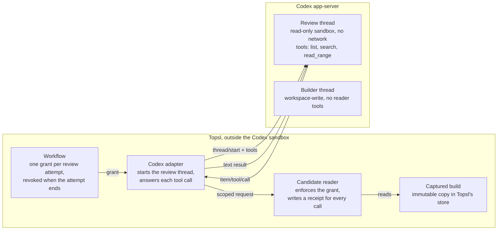

# Codex workflows plan

Plan for running Topsl's **Build and review** workflow with Codex in both roles. The project owner approved it on 16 October 2026 with every recommendation under [Decisions](#decisions). Progress and validation for each step are recorded under [Delivery record](#delivery-record).

Code links are pinned to `d8eda1e`, the `main` commit the plan was written against, because their line numbers drift as the steps land.

## Goal

The workflow should run with a real Codex in both roles: one Codex session builds, a fresh one reviews, and the owner accepts the result. At `d8eda1e`, no coordinated workflow can start on a real provider.

When the plan is done, the owner can:

- Describe a change and its acceptance criteria, choose Codex for the builder and the reviewer, and start the workflow.
- Let Codex build in the workspace Topsl manages, while Topsl captures what it produced.
- Have a fresh Codex session review that captured result through a Topsl tool that records every read.
- See the required checks, at most two repair rounds, and then accept or reject the result.

Out of scope: Claude in coordinated roles (its structured route stays refused, and it keeps its native terminal and the assisted handoff), operating-system isolation between builder and reviewer, Windows, and packaged-app distribution. Workflows that pair Claude with Codex are queued as a separate plan after this one.

## Where it stood

**What already worked**

- A Codex runtime could be qualified for the builder role. The suite runs at most four model turns and records the result for 30 days ([qualification.ts](https://github.com/Piore-Galore/Topsl/blob/d8eda1e/packages/providers/qualification.ts)).
- The reviewer's reader existed inside Topsl. It reads only the captured build it was granted, refuses anything else, and writes a receipt for every request ([candidate-reader.ts:154](https://github.com/Piore-Galore/Topsl/blob/d8eda1e/packages/context/candidate-reader.ts#L154)). Grants expire after eight hours by default ([context.ts:206-258](https://github.com/Piore-Galore/Topsl/blob/d8eda1e/packages/workspace/context.ts#L206-L258)).
- Codex CLI 0.163.0 passed a live structured chat through Topsl on 16 October 2026 ([results](Live_Provider_Sessions.md#results)).

**What blocked a Codex-only team**

1. **No reader reached a real reviewer.** The reviewer role requires a `candidate-reader` capability ([readiness.ts:46-61](https://github.com/Piore-Galore/Topsl/blob/d8eda1e/packages/providers/readiness.ts#L46-L61)). The workflow asks its driver to install the reader before a review ([builder-reviewer.ts:749-765](https://github.com/Piore-Galore/Topsl/blob/d8eda1e/packages/workflows/builder-reviewer.ts#L749-L765)), but the production driver has no such method ([service.ts:193-248](https://github.com/Piore-Galore/Topsl/blob/d8eda1e/apps/service/service.ts#L193-L248)). Only test drivers implement it, and the qualification reports the reader as not tested ([qualification.ts:548-552](https://github.com/Piore-Galore/Topsl/blob/d8eda1e/packages/providers/qualification.ts#L548-L552)).
2. **The guided setup always paired Codex with Claude.** The reviewer is always the other provider ([workflow-setup.tsx:132-133](https://github.com/Piore-Galore/Topsl/blob/d8eda1e/apps/desktop/renderer/components/workflow-setup.tsx#L132-L133)), and Claude's structured route cannot be qualified ([manager.ts:290-293](https://github.com/Piore-Galore/Topsl/blob/d8eda1e/packages/runtime/manager.ts#L290-L293)). So even with a reader, the guided setup could never assemble a ready team. The service itself accepts Codex in both roles; it only checks that each role has a trusted runtime and a model ([builder-reviewer.ts:270-285](https://github.com/Piore-Galore/Topsl/blob/d8eda1e/packages/workflows/builder-reviewer.ts#L270-L285)).
3. **A disposable test profile could not give a valid qualification.** Test profiles must sit in the OS temporary directory ([main.ts:31-41](https://github.com/Piore-Galore/Topsl/blob/d8eda1e/apps/desktop/main.ts#L31-L41)), and the qualification creates its folders inside the profile ([service.ts:2512](https://github.com/Piore-Galore/Topsl/blob/d8eda1e/apps/service/service.ts#L2512)). Codex 0.163.0's protocol schema defaults `excludeTmpdirEnvVar` and `excludeSlashTmp` to false, so its workspace-write sandbox keeps `TMPDIR` and `/tmp` writable unless a client excludes them, and Topsl does not ([codex.ts:253-261](https://github.com/Piore-Galore/Topsl/blob/d8eda1e/packages/providers/codex.ts#L253-L261)). The probe's "outside" folder was therefore writable, and the probe would fail for the wrong reason. The code already said the folder must not be temporary ([qualification.ts:114-116](https://github.com/Piore-Galore/Topsl/blob/d8eda1e/packages/providers/qualification.ts#L114-L116)), but nothing checked it.
4. **The qualification had never met a live Codex.** It had run only against a scripted stand-in ([codex-qualify.cjs](https://github.com/Piore-Galore/Topsl/blob/d8eda1e/tests/fixtures/codex-qualify.cjs)).

## Reviewer reader

**Proposal.** The reviewer reads the captured build through tools that Topsl answers itself. Codex 0.163.0 lets the client declare tools when it starts a thread (`dynamicTools` on `thread/start`). When the model calls one, Codex sends Topsl an `item/tool/call` request with the thread, turn, tool name and arguments, and Topsl replies with text and a success flag.

These names were checked on 16 October 2026 against the schema that Codex itself generates: `codex app-server generate-json-schema --experimental` from the `@openai/codex@0.163.0` npm package (linux-x64 build). The schema generated without `--experimental` has no `dynamicTools`.

The flow, in order:

1. Before a review turn, the workflow grants that one attempt access to one captured build at one revision. This step exists at `d8eda1e` ([builder-reviewer.ts:736-748](https://github.com/Piore-Galore/Topsl/blob/d8eda1e/packages/workflows/builder-reviewer.ts#L736-L748)).
2. A new production `installCandidateReader` binds the grant to the attempt. The Codex adapter then starts the review thread with three tools in a `topsl_candidate` namespace: `list`, `search` and `read_range`. Binary reads stay out of the first version.
3. On each call, the adapter checks that the thread and turn belong to that attempt and fills in the project, workflow, attempt and build ids itself, so the model never supplies them. The existing reader then enforces the grant and writes a receipt, whether it returns text or refuses.
4. When the attempt ends, Topsl revokes the grant ([context.ts:266-268](https://github.com/Piore-Galore/Topsl/blob/d8eda1e/packages/workspace/context.ts#L266-L268)), so a late call is refused.

**Why this route**

- The tools run inside Topsl, outside Codex's sandbox. The reviewer's read-only sandbox stays as strict as it is, and no socket, token or helper process is handed to Codex.
- Only the review thread has the tools. The builder's thread never sees them.
- Every tool call passes through Topsl and leaves a receipt.

**What it costs.** `dynamicTools` and `item/tool/call` belong to Codex's experimental API. Topsl must opt in when it connects (`capabilities.experimentalApi` in `initialize`), which its runtime connection does not do at `d8eda1e` ([rpc.ts:126-136](https://github.com/Piore-Galore/Topsl/blob/d8eda1e/packages/runtime/rpc.ts#L126-L136)); its project sync already opts in ([codex-projects.ts:459-464](https://github.com/Piore-Galore/Topsl/blob/d8eda1e/packages/workspace/codex-projects.ts#L459-L464)). Experimental fields can change in any Codex release. A qualification is already tied to the exact Codex executable, so a new version needs a new qualification anyway, and the reader probe below would catch a break.

**Fallback.** Codex could instead launch a small MCP server that reaches Topsl's context socket with a grant token. That uses Codex's stable MCP support, but the token has to travel to a process Codex starts, and it is unverified whether a per-thread `config` override starts an MCP server for one thread only. It stays in reserve in case the experimental API changes.

## Same-provider team

**Proposal.** The guided setup lets Codex review Codex, and picks that by default when the builder is Codex, because Claude cannot be qualified for a coordinated role. The service already accepts this pairing, so the change is the provider choice in the setup screen and the wording around it. Two Codex roles fit within the limit of two concurrent sessions per provider ([concurrency.ts:29](https://github.com/Piore-Galore/Topsl/blob/d8eda1e/packages/runtime/concurrency.ts#L29)).

**What a Codex reviewer still gives**

- A fresh Codex session for each review, with no history from the build. The qualification checks that new threads get distinct identities.
- A read-only sandbox with no network, which the qualification also checks.
- Only the task package and the frozen build it was granted, read through the reader. It never sees the builder's conversation.
- Findings in a fixed format that the workflow parses, each tied to a file and line ([builder-reviewer.ts:139-154](https://github.com/Piore-Galore/Topsl/blob/d8eda1e/packages/workflows/builder-reviewer.ts#L139-L154)).

**What it does not give**

- A second opinion from a different model. Codex reviewing Codex can share the builder's blind spots, such as the same misreading of the task.
- Independence. The same Codex installation and ChatGPT account serve both roles, and Topsl already records this workflow's isolation as not enforced ([builder-reviewer.ts:1318](https://github.com/Piore-Galore/Topsl/blob/d8eda1e/packages/workflows/builder-reviewer.ts#L1318)).
- Separate usage. Both roles draw on the same ChatGPT plan.

The advanced templates that require an independent reviewer stay blocked, because nothing provides the `independent-isolation` capability they need ([advanced.ts:330-339](https://github.com/Piore-Galore/Topsl/blob/d8eda1e/packages/workflows/advanced.ts#L330-L339)).

The setup screen and the workflow page name the pairing plainly, for example: "Codex reviews Codex in a fresh, read-only session. This is not an independent second model." The workflow record keeps both providers, so a later reader can tell which pairing produced a result.

## Qualification

**Covering the reader within four turns.** The owner approved up to four Codex turns for a qualification, and the suite already uses four. So the reader probe shares the first review turn, which at `d8eda1e` only asks for a marker reply ([qualification.ts:399-417](https://github.com/Piore-Galore/Topsl/blob/d8eda1e/packages/providers/qualification.ts#L399-L417)). For the probe, Topsl captures a one-file build and keeps it only in its own store, so the file's second random marker is in no folder the model can read. The prompt asks the model to reply with the first marker, read that file with `read_range`, and quote the second marker. Topsl records two separate results:

- `structured-turn` passes, as before, when the turn completes and returns the first marker.
- `candidate-reader` passes only when Topsl answered a `read_range` call for that file under that attempt's grant, and the reply contains the second marker.

The live probe tests the channel: that Codex delivers tool calls from a read-only review thread and passes Topsl's answers back. Scope enforcement happens in Topsl's own code and is covered by automated tests, so it needs no model turn. The qualification also uses the same handshake as real reviews: Topsl opts into the experimental API on every Codex runtime connection, so what is qualified is the route that runs.

With Codex in both roles on one installation, one qualification covers both. A qualification binds to the installation and its signed-in account, not to the chosen model ([manager.ts:120-126](https://github.com/Piore-Galore/Topsl/blob/d8eda1e/packages/runtime/manager.ts#L120-L126)).

**Fixing the temporary-folder problem**

1. The qualification refuses to start when its folder resolves inside the OS temporary directory or `/tmp`, and says why. This turns the existing comment into a check, so a run that cannot be valid never spends turns.
2. Test profiles get their own qualification folder. Only in a development build with a test profile, `TOPSL_TEST_QUALIFICATION_DIR` names a new `topsl-qualify-*` folder outside the temporary folders, for example under `~/Library/Caches`. A packaged Topsl never reads it.

A third option, stopping Codex builders from writing to `TMPDIR` and `/tmp` (`excludeTmpdirEnvVar` and `excludeSlashTmp`), is not proposed. Many build and test tools write temporary files there, so it would likely break real builds.

**The live run on the owner's Mac.** The owner chose to run it once. After the reader and both fixes are merged, a new qualification mode in [`scripts/live-session.mjs`](../scripts/live-session.mjs) does it through Topsl's own interface:

- A disposable profile, with its qualification folder under `~/Library/Caches`.
- Codex CLI 0.163.0 with the owner's existing ChatGPT sign-in, at most four turns, run once with no automatic retry.
- The script approves only the expected dialogs, as the live session already does, and saves Topsl's qualification report.
- The result goes into [Live provider sessions](Live_Provider_Sessions.md) and [Implementation status](Implementation_Status.md), with the date, versions, commit, each probe's outcome and what it leaves open.

This run proves the suite works against a live Codex. It does not make the owner's own Topsl ready, because a qualification counts only in the profile that ran it. Day-to-day use needs **Qualify builder runtime** once in the owner's own Topsl, which uses up to four more turns.

## Security and limits

**What the reviewer can reach**

- **Through the reader:** only the build it was granted, at that revision, while its attempt runs. Every request, answered or refused, leaves a receipt. The reader serves from Topsl's own store, not from a folder on disk.
- **Through its sandbox:** Codex's read-only sandbox blocks writes and network, not reads. The reviewer works in a fresh copy of the build in the OS temporary directory ([candidates.ts:1219-1220](https://github.com/Piore-Galore/Topsl/blob/d8eda1e/packages/workflows/candidates.ts#L1219-L1220)). With shell commands it can read that copy and other files on the machine, such as the live project folder. The plan does not change this. The reader adds Topsl's own record of what was read; it does not take the shell away.
- **After the review:** Topsl compares the copy with the captured build and blocks the result if anything changed ([builder-reviewer.ts:1186-1209](https://github.com/Piore-Galore/Topsl/blob/d8eda1e/packages/workflows/builder-reviewer.ts#L1186-L1209)).

**What the builder can reach.** Its workspace, plus `TMPDIR` and `/tmp`, which Codex's workspace-write sandbox leaves writable by default, with no network ([codex.ts:253-261](https://github.com/Piore-Galore/Topsl/blob/d8eda1e/packages/providers/codex.ts#L253-L261)). Codex asks before running commands outside its list of known-safe ones, because Topsl sets its approval policy to `untrusted`.

**Planted instructions.** The builder writes what the reviewer reads, so text in the build, written by the builder or copied from elsewhere, can try to steer the review. The reviewer can't write files or reach the network, so the worst case is a skewed review. The workflow still needs its required checks to pass before it accepts anything, and the reader's tool descriptions will say that what they return is content from the build, not instructions.

**What Topsl still will not claim**

- Independence between builder and reviewer, or a second model's judgment.
- Isolation beyond what Codex's sandbox enforces. Processes that a provider starts, and external editors, stay outside Topsl's enforcement ([codex.ts:73-76](https://github.com/Piore-Galore/Topsl/blob/d8eda1e/packages/providers/codex.ts#L73-L76)).
- A qualification beyond its binding: one Codex executable, account, policy and host, for 30 days.
- Windows. The qualification uses POSIX shell probes and refuses to run there ([qualification.ts:119-122](https://github.com/Piore-Galore/Topsl/blob/d8eda1e/packages/providers/qualification.ts#L119-L122)).
- Claude in coordinated roles. Its structured route still cannot be qualified.

## Build steps

Six pull requests, in this order. Each one updates the docs it affects, passes typecheck and its targeted tests, and goes green on both CI workflows before it is merged. Steps 1 to 5 send no model requests; step 6 sends up to four, once.

1. **Qualification folder check.** Refuse a qualification folder inside the temporary folders; add `TOPSL_TEST_QUALIFICATION_DIR` for development test profiles; correct the consent dialog's wording; add this plan. Proof: tests that a temporary folder is refused before any turn starts, that the variable is ignored without a test profile, and that a folder outside the temporary folders works.
2. **Codex tool channel.** Opt into Codex's experimental API on runtime connections; let review threads declare tools; answer `item/tool/call` requests through a handler bound to one attempt. Proof: the scripted Codex stand-ins learn to call tools, and tests show that only review threads get tools, that a call naming another thread or turn is refused, and that messages match the schema Codex 0.163.0 generates.
3. **Production candidate reader.** The service's driver implements `installCandidateReader`, the adapter fills in the grant's ids, and the grant is revoked when the attempt ends. Proof: an end-to-end test with the stand-in where a review reads a file through the tool and leaves a receipt, a request outside the grant is refused with a receipt, a call after revocation is refused, and the builder never sees the tools.
4. **Reader probe in the qualification.** The first review turn also tests the reader, `candidate-reader` is recorded on its own, and the dialog and README stop saying the reader is untested. Proof: stand-in runs where the reader passes, where the model never calls it, and where it quotes the marker without calling it. Only the first passes, and every run stays within four turns.
5. **Codex reviews Codex in the guided setup.** A reviewer provider choice that defaults to Codex for a Codex builder, with the pairing named plainly on the setup screen and the workflow page. Proof: a UI test where a Codex-only team becomes ready with a runtime qualified against the stand-in, and shows the pairing note.
6. **Live qualification on the owner's Mac.** A qualification mode in `scripts/live-session.mjs`, first checked against the stand-in with no model. Proof: one live run with Codex CLI 0.163.0, at most four turns, recorded in Live provider sessions and Implementation status, including a failure if that is the result.

## Decisions

Approved on 16 October 2026, each with the recommended option:

1. **How the reviewer reaches the reader:** Codex's experimental tool API. The MCP route stays the fallback if a Codex release changes the API.
2. **Codex reviewing Codex:** offered, and the default when the builder is Codex, with the plain note that it is not an independent second model.
3. **Where the live qualification runs:** a disposable profile, with its qualification folder in a new `topsl-qualify-*` folder under `~/Library/Caches` that the run deletes afterwards. The owner's own Topsl is left untouched.
4. **Temporary folders for builders:** `TMPDIR` and `/tmp` stay writable for Codex builders, as Codex does by default, and the docs say so.
5. **A live builder-and-reviewer run:** decided after step 6, with its own turn budget.

## Delivery record

Each step adds its changes and validation here when it lands.

### Step 1: qualification folder check (16 October 2026)

**What changed**

- `runCodexQualification` calls `assertQualificationParent` before it creates a folder or starts the runtime ([qualification.ts](../packages/providers/qualification.ts)). The check resolves the folder's real path through its nearest existing ancestor, so a symbolic link cannot lead into a temporary folder, and refuses a folder inside `os.tmpdir()` or `/tmp`.
- [`apps/desktop/test-profile.ts`](../apps/desktop/test-profile.ts) reads `TOPSL_TEST_PROFILE` and the new `TOPSL_TEST_QUALIFICATION_DIR`. A packaged app, or a run without a test profile, ignores both. The qualification folder must be a `topsl-qualify-*` directory outside the OS temporary directory and `/tmp`.
- The service runs qualifications in that folder when one is set. A test profile without one refuses with a message that names the variable, and a service outside a test profile refuses the folder when it is constructed.
- The consent dialog names the folder the suite will use.
- The qualification tests moved their folders from the fixture's temporary directory to `node_modules/.cache/topsl-qualify-*`, because the suite now refuses the temporary directory.

**Validation** (16 October 2026, Linux x64 container, `main` at `cbfec68` plus this change)

- `npm run typecheck` passed.
- `npm test -- tests/runtime-qualification.test.ts tests/test-profile.test.ts`: 2 files, 13 tests passed. With the `assertQualificationParent` call removed from `runCodexQualification`, the new refusal test failed, so the test exercises the check.
- `npm test`: 36 files and 328 tests passed. 2 files and 3 tests were skipped, all opt-in: the native Codex project probe, the Round 2 stress run and the coordination benchmark.
- `npm run build` passed.
- `xvfb-run --auto-servernum npm run test:desktop` passed, including encrypted restart persistence.
- No model requests were sent. These checks ran on Linux only: macOS and Windows depend on CI, and the live qualification is step 6.

### Step 2: Codex tool channel (16 October 2026)

**What changed**

- Every Codex runtime connection sends `capabilities: { experimentalApi: true }` in `initialize` ([rpc.ts](../packages/runtime/rpc.ts)). The design records the decision under [Codex adapter](Topsl_Design.md#81-codex-adapter).
- A coordinated run can carry a `ToolBinding`: a toolset and the handler that answers its calls ([contract.ts](../packages/providers/contract.ts)). The runtime manager refuses a binding before it starts a runtime unless the run is a fresh review session on a runtime that can call tools ([manager.ts](../packages/runtime/manager.ts)). The Codex adapter declares the toolset as one namespace in `dynamicTools` on `thread/start`, and refuses to declare it on a builder or resumed thread ([codex.ts](../packages/providers/codex.ts)).
- The manager runs the bound handler for an `item/tool/call` request only when the call names the run's thread, its current turn, and a tool in the declared namespace. Otherwise it returns a failed result with the reason and does not run the handler. A session without tools refuses every call, and a handler's error comes back as a failed result. Each call is recorded as a `run.tool-call` event marked `answered`, `refused` or `failed`, without its arguments or output.
- Tool calls that Codex reports as `dynamicToolCall` items appear in the run's transcript as tool messages.
- No production code installs a toolset yet. The candidate reader is step 3.
- [`tests/fixtures/codex-app-server-0.163.0.schema.json`](../tests/fixtures/codex-app-server-0.163.0.schema.json) holds the parts of the schema that Codex CLI 0.163.0 generates (`codex app-server generate-json-schema --experimental`) that the tests check against. [`scripts/codex-schema-subset.mjs`](../scripts/codex-schema-subset.mjs) reproduces it from a newly generated schema. The scripted stand-in ([codex.cjs](../tests/fixtures/codex.cjs)) can now call a tool, and it logs every frame when `FIXTURE_LOG` is set.
- An optional native check, [`tests/codex-tools-native.test.ts`](../tests/codex-tools-native.test.ts), runs when `TOPSL_NATIVE_TOOLS_BINARY` names a Codex executable. In an empty native home it starts a fresh read-only review thread with a fixture tool through the production adapter, and checks that Codex refuses the same tool without the opt-in. It starts no turn.

**Validation** (16 October 2026, Linux x64 container, on top of step 1)

- `npm run typecheck` passed.
- `npm test -- tests/codex-tools.test.ts`: 5 tests passed. With the thread-and-turn check removed, the refusal test failed; with the manager's fresh-review guard removed, the declaration test failed.
- `npm test -- tests/codex-tools.test.ts tests/runtime.test.ts tests/coordination.test.ts tests/workflow-service.test.ts tests/runtime-qualification.test.ts`: 5 files, 43 tests passed.
- `TOPSL_NATIVE_TOOLS_BINARY=<Codex CLI 0.163.0, linux-x64> npm test -- tests/codex-tools-native.test.ts` passed. Codex accepted the opt-in and a fresh read-only review thread with a fixture tool, and without the opt-in refused the tool with `thread/start.dynamicTools requires experimentalApi capability`. No turn started.
- `npm test` on `8781913`: 37 files and 333 tests passed. 3 files and 4 tests were skipped, all opt-in: the two native Codex probes, the Round 2 stress run and the coordination benchmark.
- `npm run build` and `xvfb-run --auto-servernum npm run test:desktop` passed on `fc3e000`. The later commit adds only the opt-in native check and docs.
- Not established: a live model calling a tool through the channel, which the reader probe in step 4 and the live run in step 6 cover. That Codex sends the declared namespace and the function name as the call's `namespace` and `tool` fields is read from the schema, not observed. macOS and Windows depend on CI.
