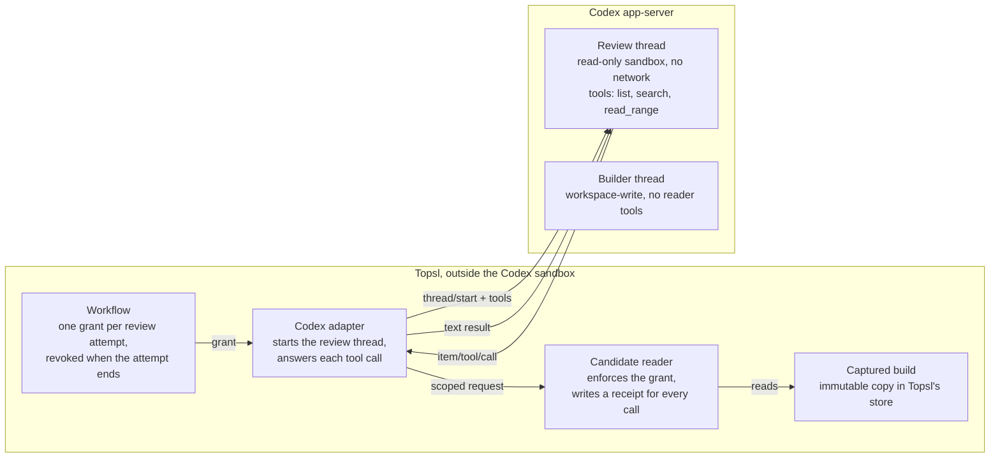

# Codex workflows plan

Plan for running Topsl's **Build and review** workflow with Codex in both roles. The project owner approved it on 16 October 2026 with every recommendation under [Decisions](#decisions). Progress and validation for each step are recorded under [Delivery record](#delivery-record).

Code links are pinned to `d8eda1e`, the `main` commit the plan was written against, because their line numbers drift as the steps land.

## Goal

The workflow should run with a real Codex in both roles: one Codex session builds, a fresh one reviews, and the owner accepts the result. At `d8eda1e`, no coordinated workflow can start on a real provider.

When the plan is done, the owner can:

- Describe a change and its acceptance criteria, choose Codex for the builder and the reviewer, and start the workflow.
- Let Codex build in the workspace Topsl manages, while Topsl captures what it produced.
- Have a fresh Codex session review that captured result through a Topsl tool that records every read.
- See the required checks, at most two repair rounds, and then accept or reject the result.

Out of scope: Claude in coordinated roles (its structured route stays refused, and it keeps its native terminal and the assisted handoff), operating-system isolation between builder and reviewer, Windows, and packaged-app distribution. Workflows that pair Claude with Codex are queued as a separate plan after this one.

## Where it stood

**What already worked**

- A Codex runtime could be qualified for the builder role. The suite runs at most four model turns and records the result for 30 days ([qualification.ts](https://github.com/Piore-Galore/Topsl/blob/d8eda1e/packages/providers/qualification.ts)).
- The reviewer's reader existed inside Topsl. It reads only the captured build it was granted, refuses anything else, and writes a receipt for every request ([candidate-reader.ts:154](https://github.com/Piore-Galore/Topsl/blob/d8eda1e/packages/context/candidate-reader.ts#L154)). Grants expire after eight hours by default ([context.ts:206-258](https://github.com/Piore-Galore/Topsl/blob/d8eda1e/packages/workspace/context.ts#L206-L258)).
- Codex CLI 0.163.0 passed a live structured chat through Topsl on 16 October 2026 ([results](Live_Provider_Sessions.md#results)).

**What blocked a Codex-only team**

1. **No reader reached a real reviewer.** The reviewer role requires a `candidate-reader` capability ([readiness.ts:46-61](https://github.com/Piore-Galore/Topsl/blob/d8eda1e/packages/providers/readiness.ts#L46-L61)). The workflow asks its driver to install the reader before a review ([builder-reviewer.ts:749-765](https://github.com/Piore-Galore/Topsl/blob/d8eda1e/packages/workflows/builder-reviewer.ts#L749-L765)), but the production driver has no such method ([service.ts:193-248](https://github.com/Piore-Galore/Topsl/blob/d8eda1e/apps/service/service.ts#L193-L248)). Only test drivers implement it, and the qualification reports the reader as not tested ([qualification.ts:548-552](https://github.com/Piore-Galore/Topsl/blob/d8eda1e/packages/providers/qualification.ts#L548-L552)).
2. **The guided setup always paired Codex with Claude.** The reviewer is always the other provider ([workflow-setup.tsx:132-133](https://github.com/Piore-Galore/Topsl/blob/d8eda1e/apps/desktop/renderer/components/workflow-setup.tsx#L132-L133)), and Claude's structured route cannot be qualified ([manager.ts:290-293](https://github.com/Piore-Galore/Topsl/blob/d8eda1e/packages/runtime/manager.ts#L290-L293)). So even with a reader, the guided setup could never assemble a ready team. The service itself accepts Codex in both roles; it only checks that each role has a trusted runtime and a model ([builder-reviewer.ts:270-285](https://github.com/Piore-Galore/Topsl/blob/d8eda1e/packages/workflows/builder-reviewer.ts#L270-L285)).
3. **A disposable test profile could not give a valid qualification.** Test profiles must sit in the OS temporary directory ([main.ts:31-41](https://github.com/Piore-Galore/Topsl/blob/d8eda1e/apps/desktop/main.ts#L31-L41)), and the qualification creates its folders inside the profile ([service.ts:2512](https://github.com/Piore-Galore/Topsl/blob/d8eda1e/apps/service/service.ts#L2512)). Codex 0.163.0's protocol schema defaults `excludeTmpdirEnvVar` and `excludeSlashTmp` to false, so its workspace-write sandbox keeps `TMPDIR` and `/tmp` writable unless a client excludes them, and Topsl does not ([codex.ts:253-261](https://github.com/Piore-Galore/Topsl/blob/d8eda1e/packages/providers/codex.ts#L253-L261)). The probe's "outside" folder was therefore writable, and the probe would fail for the wrong reason. The code already said the folder must not be temporary ([qualification.ts:114-116](https://github.com/Piore-Galore/Topsl/blob/d8eda1e/packages/providers/qualification.ts#L114-L116)), but nothing checked it.
4. **The qualification had never met a live Codex.** It had run only against a scripted stand-in ([codex-qualify.cjs](https://github.com/Piore-Galore/Topsl/blob/d8eda1e/tests/fixtures/codex-qualify.cjs)).

## Reviewer reader

**Proposal.** The reviewer reads the captured build through tools that Topsl answers itself. Codex 0.163.0 lets the client declare tools when it starts a thread (`dynamicTools` on `thread/start`). When the model calls one, Codex sends Topsl an `item/tool/call` request with the thread, turn, tool name and arguments, and Topsl replies with text and a success flag.

These names were checked on 16 October 2026 against the schema that Codex itself generates: `codex app-server generate-json-schema --experimental` from the `@openai/codex@0.163.0` npm package (linux-x64 build). The schema generated without `--experimental` has no `dynamicTools`.

The flow, in order:

1. Before a review turn, the workflow grants that one attempt access to one captured build at one revision. This step exists at `d8eda1e` ([builder-reviewer.ts:736-748](https://github.com/Piore-Galore/Topsl/blob/d8eda1e/packages/workflows/builder-reviewer.ts#L736-L748)).
2. A new production `installCandidateReader` binds the grant to the attempt. The Codex adapter then starts the review thread with three tools in a `topsl_candidate` namespace: `list`, `search` and `read_range`. Binary reads stay out of the first version.
3. On each call, the adapter checks that the thread and turn belong to that attempt and fills in the project, workflow, attempt and build ids itself, so the model never supplies them. The existing reader then enforces the grant and writes a receipt, whether it returns text or refuses.
4. When the attempt ends, Topsl revokes the grant ([context.ts:266-268](https://github.com/Piore-Galore/Topsl/blob/d8eda1e/packages/workspace/context.ts#L266-L268)), so a late call is refused.

**Why this route**

- The tools run inside Topsl, outside Codex's sandbox. The reviewer's read-only sandbox stays as strict as it is, and no socket, token or helper process is handed to Codex.
- Only the review thread has the tools. The builder's thread never sees them.
- Every tool call passes through Topsl and leaves a receipt.

**What it costs.** `dynamicTools` and `item/tool/call` belong to Codex's experimental API. Topsl must opt in when it connects (`capabilities.experimentalApi` in `initialize`), which its runtime connection does not do at `d8eda1e` ([rpc.ts:126-136](https://github.com/Piore-Galore/Topsl/blob/d8eda1e/packages/runtime/rpc.ts#L126-L136)); its project sync already opts in ([codex-projects.ts:459-464](https://github.com/Piore-Galore/Topsl/blob/d8eda1e/packages/workspace/codex-projects.ts#L459-L464)). Experimental fields can change in any Codex release. A qualification is already tied to the exact Codex executable, so a new version needs a new qualification anyway, and the reader probe below would catch a break.

**Fallback.** Codex could instead launch a small MCP server that reaches Topsl's context socket with a grant token. That uses Codex's stable MCP support, but the token has to travel to a process Codex starts, and it is unverified whether a per-thread `config` override starts an MCP server for one thread only. It stays in reserve in case the experimental API changes.

## Same-provider team

**Proposal.** The guided setup lets Codex review Codex, and picks that by default when the builder is Codex, because Claude cannot be qualified for a coordinated role. The service already accepts this pairing, so the change is the provider choice in the setup screen and the wording around it. Two Codex roles fit within the limit of two concurrent sessions per provider ([concurrency.ts:29](https://github.com/Piore-Galore/Topsl/blob/d8eda1e/packages/runtime/concurrency.ts#L29)).

**What a Codex reviewer still gives**

- A fresh Codex session for each review, with no history from the build. The qualification checks that new threads get distinct identities.
- A read-only sandbox with no network, which the qualification also checks.
- Only the task package and the frozen build it was granted, read through the reader. It never sees the builder's conversation.
- Findings in a fixed format that the workflow parses, each tied to a file and line ([builder-reviewer.ts:139-154](https://github.com/Piore-Galore/Topsl/blob/d8eda1e/packages/workflows/builder-reviewer.ts#L139-L154)).

**What it does not give**

- A second opinion from a different model. Codex reviewing Codex can share the builder's blind spots, such as the same misreading of the task.
- Independence. The same Codex installation and ChatGPT account serve both roles, and Topsl already records this workflow's isolation as not enforced ([builder-reviewer.ts:1318](https://github.com/Piore-Galore/Topsl/blob/d8eda1e/packages/workflows/builder-reviewer.ts#L1318)).
- Separate usage. Both roles draw on the same ChatGPT plan.

The advanced templates that require an independent reviewer stay blocked, because nothing provides the `independent-isolation` capability they need ([advanced.ts:330-339](https://github.com/Piore-Galore/Topsl/blob/d8eda1e/packages/workflows/advanced.ts#L330-L339)).

The setup screen and the workflow page name the pairing plainly, for example: "Codex reviews Codex in a fresh, read-only session. This is not an independent second model." The workflow record keeps both providers, so a later reader can tell which pairing produced a result.

## Qualification

**Covering the reader within four turns.** The owner approved up to four Codex turns for a qualification, and the suite already uses four. So the reader probe shares the first review turn, which at `d8eda1e` only asks for a marker reply ([qualification.ts:399-417](https://github.com/Piore-Galore/Topsl/blob/d8eda1e/packages/providers/qualification.ts#L399-L417)). For the probe, Topsl captures a one-file build and keeps it only in its own store, so the file's second random marker is in no folder the model can read. The prompt asks the model to reply with the first marker, read that file with `read_range`, and quote the second marker. Topsl records two separate results:

- `structured-turn` passes, as before, when the turn completes and returns the first marker.
- `candidate-reader` passes only when Topsl answered a `read_range` call for that file under that attempt's grant, and the reply contains the second marker.

The live probe tests the channel: that Codex delivers tool calls from a read-only review thread and passes Topsl's answers back. Scope enforcement happens in Topsl's own code and is covered by automated tests, so it needs no model turn. The qualification also uses the same handshake as real reviews: Topsl opts into the experimental API on every Codex runtime connection, so what is qualified is the route that runs.

With Codex in both roles on one installation, one qualification covers both. A qualification binds to the installation and its signed-in account, not to the chosen model ([manager.ts:120-126](https://github.com/Piore-Galore/Topsl/blob/d8eda1e/packages/runtime/manager.ts#L120-L126)).

**Fixing the temporary-folder problem**

1. The qualification refuses to start when its folder resolves inside the OS temporary directory or `/tmp`, and says why. This turns the existing comment into a check, so a run that cannot be valid never spends turns.
2. Test profiles get their own qualification folder. Only in a development build with a test profile, `TOPSL_TEST_QUALIFICATION_DIR` names a new `topsl-qualify-*` folder outside the temporary folders, for example under `~/Library/Caches`. A packaged Topsl never reads it.

A third option, stopping Codex builders from writing to `TMPDIR` and `/tmp` (`excludeTmpdirEnvVar` and `excludeSlashTmp`), is not proposed. Many build and test tools write temporary files there, so it would likely break real builds.

**The live run on the owner's Mac.** The owner chose to run it once. After the reader and both fixes are merged, a new qualification mode in [`scripts/live-session.mjs`](../scripts/live-session.mjs) does it through Topsl's own interface:

- A disposable profile, with its qualification folder under `~/Library/Caches`.
- Codex CLI 0.163.0 with the owner's existing ChatGPT sign-in, at most four turns, run once with no automatic retry.
- The script approves only the expected dialogs, as the live session already does, and saves Topsl's qualification report.
- The result goes into [Live provider sessions](Live_Provider_Sessions.md) and [Implementation status](Implementation_Status.md), with the date, versions, commit, each probe's outcome and what it leaves open.

This run proves the suite works against a live Codex. It does not make the owner's own Topsl ready, because a qualification counts only in the profile that ran it. Day-to-day use needs **Qualify builder runtime** once in the owner's own Topsl, which uses up to four more turns.

## Security and limits

**What the reviewer can reach**

- **Through the reader:** only the build it was granted, at that revision, while its attempt runs. Every request, answered or refused, leaves a receipt. The reader serves from Topsl's own store, not from a folder on disk.
- **Through its sandbox:** Codex's read-only sandbox blocks writes and network, not reads. The reviewer works in a fresh copy of the build in the OS temporary directory ([candidates.ts:1219-1220](https://github.com/Piore-Galore/Topsl/blob/d8eda1e/packages/workflows/candidates.ts#L1219-L1220)). With shell commands it can read that copy and other files on the machine, such as the live project folder. The plan does not change this. The reader adds Topsl's own record of what was read; it does not take the shell away.
- **After the review:** Topsl compares the copy with the captured build and blocks the result if anything changed ([builder-reviewer.ts:1186-1209](https://github.com/Piore-Galore/Topsl/blob/d8eda1e/packages/workflows/builder-reviewer.ts#L1186-L1209)).

**What the builder can reach.** Its workspace, plus `TMPDIR` and `/tmp`, which Codex's workspace-write sandbox leaves writable by default, with no network ([codex.ts:253-261](https://github.com/Piore-Galore/Topsl/blob/d8eda1e/packages/providers/codex.ts#L253-L261)). Codex asks before running commands outside its list of known-safe ones, because Topsl sets its approval policy to `untrusted`.

**Planted instructions.** The builder writes what the reviewer reads, so text in the build, written by the builder or copied from elsewhere, can try to steer the review. The reviewer can't write files or reach the network, so the worst case is a skewed review. The workflow still needs its required checks to pass before it accepts anything, and the reader's tool descriptions will say that what they return is content from the build, not instructions.

**What Topsl still will not claim**

- Independence between builder and reviewer, or a second model's judgment.
- Isolation beyond what Codex's sandbox enforces. Processes that a provider starts, and external editors, stay outside Topsl's enforcement ([codex.ts:73-76](https://github.com/Piore-Galore/Topsl/blob/d8eda1e/packages/providers/codex.ts#L73-L76)).
- A qualification beyond its binding: one Codex executable, account, policy and host, for 30 days.
- Windows. The qualification uses POSIX shell probes and refuses to run there ([qualification.ts:119-122](https://github.com/Piore-Galore/Topsl/blob/d8eda1e/packages/providers/qualification.ts#L119-L122)).
- Claude in coordinated roles. Its structured route still cannot be qualified.

## Build steps

Six pull requests, in this order. Each one updates the docs it affects, passes typecheck and its targeted tests, and goes green on both CI workflows before it is merged. Steps 1 to 5 send no model requests; step 6 sends up to four, once.

1. **Qualification folder check.** Refuse a qualification folder inside the temporary folders; add `TOPSL_TEST_QUALIFICATION_DIR` for development test profiles; correct the consent dialog's wording; add this plan. Proof: tests that a temporary folder is refused before any turn starts, that the variable is ignored without a test profile, and that a folder outside the temporary folders works.
2. **Codex tool channel.** Opt into Codex's experimental API on runtime connections; let review threads declare tools; answer `item/tool/call` requests through a handler bound to one attempt. Proof: the scripted Codex stand-ins learn to call tools, and tests show that only review threads get tools, that a call naming another thread or turn is refused, and that messages match the schema Codex 0.163.0 generates.
3. **Production candidate reader.** The service's driver implements `installCandidateReader`, the adapter fills in the grant's ids, and the grant is revoked when the attempt ends. Proof: an end-to-end test with the stand-in where a review reads a file through the tool and leaves a receipt, a request outside the grant is refused with a receipt, a call after revocation is refused, and the builder never sees the tools.
4. **Reader probe in the qualification.** The first review turn also tests the reader, `candidate-reader` is recorded on its own, and the dialog and README stop saying the reader is untested. Proof: stand-in runs where the reader passes, where the model never calls it, and where it quotes the marker without calling it. Only the first passes, and every run stays within four turns.
5. **Codex reviews Codex in the guided setup.** A reviewer provider choice that defaults to Codex for a Codex builder, with the pairing named plainly on the setup screen and the workflow page. Proof: a UI test where a Codex-only team becomes ready with a runtime qualified against the stand-in, and shows the pairing note.
6. **Live qualification on the owner's Mac.** A qualification mode in `scripts/live-session.mjs`, first checked against the stand-in with no model. Proof: one live run with Codex CLI 0.163.0, at most four turns, recorded in Live provider sessions and Implementation status, including a failure if that is the result.

## Decisions

Approved on 16 October 2026, each with the recommended option:

1. **How the reviewer reaches the reader:** Codex's experimental tool API. The MCP route stays the fallback if a Codex release changes the API.
2. **Codex reviewing Codex:** offered, and the default when the builder is Codex, with the plain note that it is not an independent second model.
3. **Where the live qualification runs:** a disposable profile, with its qualification folder in a new `topsl-qualify-*` folder under `~/Library/Caches` that the run deletes afterwards. The owner's own Topsl is left untouched.
4. **Temporary folders for builders:** `TMPDIR` and `/tmp` stay writable for Codex builders, as Codex does by default, and the docs say so.
5. **A live builder-and-reviewer run:** decided after step 6, with its own turn budget.

## Delivery record

Each step adds its changes and validation here when it lands.

### Step 1: qualification folder check (16 October 2026)

**What changed**

- `runCodexQualification` calls `assertQualificationParent` before it creates a folder or starts the runtime ([qualification.ts](../packages/providers/qualification.ts)). The check resolves the folder's real path through its nearest existing ancestor, so a symbolic link cannot lead into a temporary folder, and refuses a folder inside `os.tmpdir()` or `/tmp`.
- [`apps/desktop/test-profile.ts`](../apps/desktop/test-profile.ts) reads `TOPSL_TEST_PROFILE` and the new `TOPSL_TEST_QUALIFICATION_DIR`. A packaged app, or a run without a test profile, ignores both. The qualification folder must be a `topsl-qualify-*` directory outside the OS temporary directory and `/tmp`.
- The service runs qualifications in that folder when one is set. A test profile without one refuses with a message that names the variable, and a service outside a test profile refuses the folder when it is constructed.
- The consent dialog names the folder the suite will use.
- The qualification tests moved their folders from the fixture's temporary directory to `node_modules/.cache/topsl-qualify-*`, because the suite now refuses the temporary directory.

**Validation** (16 October 2026, Linux x64 container, `main` at `cbfec68` plus this change)

- `npm run typecheck` passed.
- `npm test -- tests/runtime-qualification.test.ts tests/test-profile.test.ts`: 2 files, 13 tests passed. With the `assertQualificationParent` call removed from `runCodexQualification`, the new refusal test failed, so the test exercises the check.
- `npm test`: 36 files and 328 tests passed. 2 files and 3 tests were skipped, all opt-in: the native Codex project probe, the Round 2 stress run and the coordination benchmark.
- `npm run build` passed.
- `xvfb-run --auto-servernum npm run test:desktop` passed, including encrypted restart persistence.
- No model requests were sent. These checks ran on Linux only: macOS and Windows depend on CI, and the live qualification is step 6.

### Step 2: Codex tool channel (16 October 2026)

**What changed**

- Every Codex runtime connection sends `capabilities: { experimentalApi: true }` in `initialize` ([rpc.ts](../packages/runtime/rpc.ts)). The design records the decision under [Codex adapter](Topsl_Design.md#81-codex-adapter).
- A coordinated run can carry a `ToolBinding`: a toolset and the handler that answers its calls ([contract.ts](../packages/providers/contract.ts)). The runtime manager refuses a binding before it starts a runtime unless the run is a fresh review session on a runtime that can call tools ([manager.ts](../packages/runtime/manager.ts)). The Codex adapter declares the toolset as one namespace in `dynamicTools` on `thread/start`, and refuses to declare it on a builder or resumed thread ([codex.ts](../packages/providers/codex.ts)).
- The manager runs the bound handler for an `item/tool/call` request only when the call names the run's thread, its current turn, and a tool in the declared namespace. Otherwise it returns a failed result with the reason and does not run the handler. A session without tools refuses every call, and a handler's error comes back as a failed result. Each call is recorded as a `run.tool-call` event marked `answered`, `refused` or `failed`, without its arguments or output.
- Tool calls that Codex reports as `dynamicToolCall` items appear in the run's transcript as tool messages.
- No production code installs a toolset yet. The candidate reader is step 3.
- [`tests/fixtures/codex-app-server-0.163.0.schema.json`](../tests/fixtures/codex-app-server-0.163.0.schema.json) holds the parts of the schema that Codex CLI 0.163.0 generates (`codex app-server generate-json-schema --experimental`) that the tests check against. [`scripts/codex-schema-subset.mjs`](../scripts/codex-schema-subset.mjs) reproduces it from a newly generated schema. The scripted stand-in ([codex.cjs](../tests/fixtures/codex.cjs)) can now call a tool, and it logs every frame when `FIXTURE_LOG` is set.
- An optional native check, [`tests/codex-tools-native.test.ts`](../tests/codex-tools-native.test.ts), runs when `TOPSL_NATIVE_TOOLS_BINARY` names a Codex executable. In an empty native home it starts a fresh read-only review thread with a fixture tool through the production adapter, and checks that Codex refuses the same tool without the opt-in. It starts no turn.

**Validation** (16 October 2026, Linux x64 container, on top of step 1)

- `npm run typecheck` passed.
- `npm test -- tests/codex-tools.test.ts`: 5 tests passed. With the thread-and-turn check removed, the refusal test failed; with the manager's fresh-review guard removed, the declaration test failed.
- `npm test -- tests/codex-tools.test.ts tests/runtime.test.ts tests/coordination.test.ts tests/workflow-service.test.ts tests/runtime-qualification.test.ts`: 5 files, 43 tests passed.
- `TOPSL_NATIVE_TOOLS_BINARY=<Codex CLI 0.163.0, linux-x64> npm test -- tests/codex-tools-native.test.ts` passed. Codex accepted the opt-in and a fresh read-only review thread with a fixture tool, and without the opt-in refused the tool with `thread/start.dynamicTools requires experimentalApi capability`. No turn started.
- `npm test` on `8781913`: 37 files and 333 tests passed. 3 files and 4 tests were skipped, all opt-in: the two native Codex probes, the Round 2 stress run and the coordination benchmark.
- `npm run build` and `xvfb-run --auto-servernum npm run test:desktop` passed on `fc3e000`. The later commit adds only the opt-in native check and docs.
- Not established: a live model calling a tool through the channel, which the reader probe in step 4 and the live run in step 6 cover. That Codex sends the declared namespace and the function name as the call's `namespace` and `tool` fields is read from the schema, not observed. macOS and Windows depend on CI.
- CI on `4585808`: Windows x64 failed four of the five tool-channel tests with "This workspace already has a native session or writer lease." Each test started its next run as soon as the previous one reported completed, but Topsl frees the workspace only once it confirms the process exited, which takes longer on Windows. A stand-in that ignored `SIGTERM` reproduced the same four failures on Linux. The tests now wait for that confirmation before the next run, and pass with that stand-in and with the normal one.

### Step 3: candidate reader (16 October 2026)

**What changed**

- The service's workflow driver implements `installCandidateReader` for review attempts and refuses any other ([service.ts](../apps/service/service.ts)). It binds the attempt's grant to the reader tools in [candidate-tools.ts](../packages/context/candidate-tools.ts) and passes them to the runtime with the review dispatch, so they are declared on the fresh review thread.
- The tools are `list`, `search` and `read_range` in a `topsl_candidate` namespace, mapped to the reader's `candidate-list`, `candidate-search` and `candidate-read-range`. Binary reads stay out, as planned. A call passes on only its own arguments, and Topsl fills in the project, workflow, attempt, candidate and revision ids. The descriptions say that what the tools return is content from the candidate, not instructions. A result is the reader's JSON.
- The context server answers these calls inside Topsl with the same checks as its socket, which now share one method ([context.ts](../packages/workspace/context.ts)): an unknown, expired or revoked grant is refused before the reader, so it leaves no receipt. Under a live grant the reader enforces the scope and writes its receipt, answered or refused, as before.
- The workflow revokes an attempt's grant whenever it finds the attempt has ended, not only when it completed ([builder-reviewer.ts](../packages/workflows/builder-reviewer.ts)). Until then, the runtime manager refuses calls from a run that has ended.
- The `run.tool-call` event of a refused or failed call now records the reason. An answer's content is still not kept there.
- **Builders and repairs read their workspace.** The plan gives tools only to the review thread, but the workflow required an installed reader for any role whose task input left out some text, which on most real projects includes the builder's. A builder or repair works in the live workspace its candidate was captured from, and the workflow checks that the workspace still matches the candidate before it dispatches. So only a reviewer's task input can require retrieval now ([packages.ts](../packages/context/packages.ts)). A builder's input says that files it does not show in full are in its workspace, and the workflow records the builder's grant delivery as `workspace-read`. The reviewer's input names the reader tools.
- The qualification's not-tested note for `candidate-reader` now says the suite does not test the reader yet. Production reviewers stay blocked until step 4.
- When the review thread declares the reader, the workflow stand-in ([codex-workflow.cjs](../tests/fixtures/codex-workflow.cjs)) calls `read_range` for each text file its task input leaves out and for one path outside the candidate, and quotes what came back in its review. It logs every frame when `FIXTURE_LOG` is set.
- The optional native check declares the reader's own tools instead of a fixture tool.

**Validation** (16 October 2026, Linux x64 container, on top of step 2 at `f30f24e` unless noted)

- `npm run typecheck` passed.
- `npm test -- tests/workflow-service.test.ts`: 6 tests passed, two of them new. In the first, a Codex builder and a Codex reviewer run end to end through the service with the stand-in. Only the review thread's `thread/start` declares `topsl_candidate`. The review reads a file of about 32 KB through `read_range`, and Topsl refuses a path outside the candidate; both requests left receipts under the review attempt, and the stand-in's review quotes the file's last line, so the answer reached the thread. The grant is revoked once the review completes. In the second, a review turn that fails still has its grant revoked.
- `npm test -- tests/candidate-tools.test.ts`: 2 tests passed. Each tool reaches the reader with the ids Topsl fills in, and ids in the arguments are ignored. A path outside the grant is refused with a receipt, and a call after revocation is refused before the reader. This test drives the tools directly against a real context server, not through the stand-in: in the workflow a grant is revoked when its attempt ends or is cancelled, which leaves the stand-in no turn to call from.
- Each of these changes made a test fail: not passing the tools to the runtime; letting a builder's input require retrieval again, which blocked the builder; letting ids in the arguments override Topsl's; and dropping the revocation for an attempt that did not complete.
- R2-AT-37/38 now expects the reader for its two review attempts only. It used to count a reader for all four attempts.
- `TOPSL_NATIVE_TOOLS_BINARY=<Codex CLI 0.163.0, linux-x64> npm test -- tests/codex-tools-native.test.ts` passed. Codex accepted the reader's tools on a fresh read-only review thread and refused them without the opt-in. No turn started.
- `npm test`: 38 files and 337 tests passed. 3 files and 4 tests were skipped, all opt-in: the two native Codex probes, the Round 2 stress run and the coordination benchmark.
- Step 3 was then rebased onto step 2 at `a51efe7`, which merges main into step 2. That adds only the failure message for R2-AT-37/38 from [pull request #5](https://github.com/Piore-Galore/Topsl/pull/5) and its note in [Round_2_Execution.md](Round_2_Execution.md). On the rebased tree, `npm run typecheck`, R2-AT-37/38 and `tests/runtime-qualification.test.ts` passed again, and so did `npm run build` and `xvfb-run --auto-servernum npm run test:desktop`, including encrypted restart persistence.
- Not established: a live model calling the reader, which steps 4 and 6 cover, and whether Codex checks the tools' input schemas again when it sends a model request; `thread/start` accepted them. macOS and Windows depend on CI.

### Step 4: reader probe in the qualification (16 October 2026)

**What changed**

- The suite is now `codex-runtime-qualification/v2` ([qualification.ts](../packages/providers/qualification.ts)). Its first review turn, which already asked for a marker reply, also asks the model to read one file with `read_range` and quote its line. Only that turn's thread declares the reader's tools. The suite still starts at most four turns.
- Before the runtime starts, the qualification prepares the probe ([reader-probe.ts](../packages/context/reader-probe.ts)). It writes a one-line file holding a random marker to a new folder in the OS temporary directory, captures it into a new encrypted store inside the qualification folder, and deletes the folder. It then grants one probe attempt access to the captured build, as the workflow grants a review. A separate store keeps the probe's records out of the profile's history, and because it is encrypted, no file the model can read holds the marker. The file starts in the temporary directory because capture refuses a folder inside a Git checkout unless it is the checkout's root, and the qualification folder can sit inside one, as it does in the tests.
- The probe uses the reviewer's own tools (`candidateTools`) under a context server grant, so its calls go through the same grant check and reader, and leave the same receipts, as a review's.
- `candidate-reader` is recorded on its own. It passes only when the turn completed, a `read_range` answer under the probe's grant returned the whole marker, and the reply quotes it. A reply that quotes the marker without such an answer does not pass, and neither does a read that returned only part of the file. The probe's grant is revoked when the turn ends.
- The runtime manager and the qualification answer tool calls through one function, `answerToolCall` ([tool-calls.ts](../packages/providers/tool-calls.ts)), which refuses a call from another thread or turn, or for an undeclared tool, before it runs the handler.
- If the runtime refuses the tools when the first thread starts, the qualification starts that thread again without them; if Topsl cannot prepare the probe, it starts it without them. Either way `candidate-reader` is recorded as failed with the reason, and the other probes still run, so a Codex release that changes the tool API can still be qualified as a builder. Starting a thread is not a model turn.
- Readiness needed no change: a passing `candidate-reader` observation meets the reviewer role's requirement, so a passing run now makes a Codex runtime ready to review as well as to build. The guided setup still pairs Codex with Claude until step 5.
- The consent dialog lists the reader probe and no longer says the suite leaves the reader untested. README and Implementation status say the same.

**Validation** (16 October 2026, Linux x64 container, on top of step 3)

- `npm run typecheck` passed.
- `npm test -- tests/runtime-qualification.test.ts`: 13 tests passed, 4 of them new.
  - With the stand-in ([codex-qualify.cjs](../tests/fixtures/codex-qualify.cjs)) reading the file through the tool and quoting it, every probe passed within four turns, nothing was left untested, and only the first thread declared the reader's tools.
  - In seven stand-in runs of four turns each, only the run that read the file and quoted it passed `candidate-reader`. The others never called the tool, quoted the marker without calling it, read the file without quoting it, read only its first 4 bytes and quoted a marker they had anyway, read a path outside the build, or called the tool naming another turn. `structured-turn` passed in all seven.
  - When the probe was prepared, no Codex process had started, the file's folder was gone, and no file in the qualification folder, the probe's store included, contained the marker.
  - When the stand-in refused the tools on `thread/start`, with the error Codex 0.163.0 gives without the opt-in, or the probe could not be prepared, `candidate-reader` failed with the reason and the other probes passed.
  - Through the runtime manager, a passing run made the reviewer ready as well as the implementer, and the independent reviewer stayed blocked. A stand-in that never called the reader left the reviewer blocked with `candidate-reader-unavailable`.
- Each of these changes made a test fail: passing without an answered read, passing without the quote, checking the call against its own turn instead of the session's, and counting any returned range of the file.
- `npm test -- tests/codex-tools.test.ts tests/runtime.test.ts tests/coordination.test.ts tests/workflow-service.test.ts tests/runtime-qualification.test.ts tests/candidate-tools.test.ts`: 6 files, 51 tests passed.
- `npm test` on `a136cd9`: 38 files and 341 tests passed. 3 files and 4 tests were skipped, all opt-in: the two native Codex probes, the Round 2 stress run and the coordination benchmark.
- `npm run build` and `xvfb-run --auto-servernum npm run test:desktop` passed on `a136cd9`, including encrypted restart persistence. The docs commit after it changes no code.
- No model requests were sent. Not established: that a live Codex model calls the tool and quotes its answer, which step 6 covers, and the dialog's new wording in the running app. macOS and Windows depend on CI.

### Step 5: Codex reviews Codex in the guided setup (16 October 2026)

**What changed**

- The guided setup's Team step offers three pairings: Codex builds · Codex reviews, Codex builds · Claude reviews, and Claude builds · Codex reviews ([workflow-setup.tsx](../apps/desktop/renderer/components/workflow-setup.tsx)). A new draft starts with Codex in both roles. A saved draft with a pairing the list does not offer, such as Claude in both roles, which only a direct `workflow-draft-save` command can save, is still shown as saved.
- A workflow draft records the reviewer's provider in a new `reviewer` field ([workflow-drafts.ts](../packages/domain/workflow-drafts.ts)). A draft saved before the field existed reloads with the pairing the setup gave it then, the builder's opposite provider ([drafts.ts](../packages/workflows/drafts.ts)), so an existing draft does not silently switch to Codex reviewing Codex.
- With Codex in both roles, the Team step, the Review and start step and the workflow's card say: "Codex reviews Codex in a fresh, read-only session. This is not an independent second model." The workflow record already kept both providers, and the card still shows them.
- The service needed no change. It already accepted Codex in both roles, and since step 4 one qualification satisfies both roles on one installation.
- The qualification stand-in ([codex-qualify.cjs](../tests/fixtures/codex-qualify.cjs)) now answers `--version` and lists one model, so the desktop test can register, connect and qualify it through Topsl's own screens.

**Validation** (16 October 2026, Linux x64 container, on top of step 4)

- `npm run typecheck` passed.
- `npm test -- tests/workflow-drafts.test.ts tests/runtime-qualification.test.ts`: 15 tests passed. The new one checks that a new draft pairs Codex with Codex, that a saved Claude reviewer stays Claude, and that drafts saved without a reviewer reload as Codex with Claude and as Claude with Codex. Removing that reload made it fail.
- `npm run build` and `xvfb-run --auto-servernum npm run test:desktop` passed on `fd522ad`. On macOS and Linux, the desktop test now registers and trusts the qualification stand-in, then uses the guided setup as a user would. The Team step starts as Codex builds · Codex reviews and shows the note. **Validate builder runtime**, **Discover builder models** and **Qualify builder runtime** record a qualification in four turns with every probe passed, `candidate-reader` among them, and nothing untested, and both roles show as satisfied. With a self-contained check recipe and one change boundary, the workflow is captured. Its card shows Codex in both roles, the note and `ready build`, because capture starts no build. Windows skips this part, because the qualification runs only on macOS and Linux.
- `xvfb-run --auto-servernum node scripts/round2-ui-test.mjs` passed. This manual harness assumed the old default. It now checks the new default and the note, then picks Codex builds · Claude reviews for its run. Its old version failed against the new setup.
- `npm test` on `fd522ad`: 38 files and 342 tests passed. 3 files and 4 tests were skipped, the same opt-in ones as in step 4.
- No model requests were sent. Not established: a live Codex qualified for both roles, which step 6 covers, and a live builder-and-reviewer run, which waits for decision 5. macOS and Windows depend on CI.

### Step 6: live qualification (16 October 2026)

**What changed**

- `node scripts/live-session.mjs --qualify --codex <path>` runs the runtime qualification through Topsl's own screens ([live-session.mjs](../scripts/live-session.mjs)). After it locates and trusts the executable and adds a disposable project, it connects Codex with **Models & account**. In the guided setup it then chooses Codex builds · Codex reviews, selects the runtime and the model for both roles, and presses **Qualify builder runtime**. The model is the one Codex reports as default unless `--model` names another.
- The disposable profile gets `TOPSL_TEST_QUALIFICATION_DIR`, a new `topsl-qualify-*` folder in `~/Library/Caches` on macOS or `~/.cache` on Linux. The script deletes it after every run, as decision 3 says.
- The script approves Topsl's qualification dialog once, and only when its text names the selected executable, the chosen model, up to 4 model turns and that folder. It never retries: the approval is used up, so a second dialog would be cancelled. A run also fails if Topsl reports more than four turns started.
- The report keeps what Topsl recorded, including each probe's outcome and detail, with only the account type and plan and with the home folder written as `~`. It also keeps both roles' readiness from Topsl's readiness query and from the guided setup. A run passes only if every probe passed, none was left untested, the qualification was recorded and both roles are ready. A failed run keeps the same record.
- `--model` must name a model Codex reports. The script now stops with `Codex did not report the model …` before using it, for a session check as well.
- [`tests/fixtures/live-session/codex-qualify.cjs`](../tests/fixtures/live-session/codex-qualify.cjs) is the procedure's stand-in. It runs the suite's scripted app-server.
- [Live provider sessions](Live_Provider_Sessions.md#codex-runtime-qualification) describes the mode, and README lists the command.

**Validation** (16 October 2026, Linux x64 container, on top of step 5)

- After `npm run build`, `xvfb-run --auto-servernum node scripts/live-session.mjs --qualify --codex "$PWD/tests/fixtures/live-session/codex-qualify.cjs"` passed on `93328aa`. Every probe passed in 4 turns and the qualification was recorded for 30 days. Both roles were ready in the readiness query, and the guided setup showed both satisfied. The qualification folder and the profile were deleted.
- With `FIXTURE_READER=skip` in the script's environment, the stand-in still called the reader and the run passed. Topsl passes a runtime only a fixed list of environment variables (`nativeEnvironment` in [system.ts](../packages/platform/system.ts)). A wrapper that sets the variable itself, as Live provider sessions shows, made the stand-in skip the reader. That run failed with `Not passed: candidate-reader.` The builder stayed ready and the reviewer was blocked by `candidate-reader-unavailable`, and the guided setup showed one role satisfied. The qualification folder was deleted, and the profile was kept for inspection.
- `--model not-reported` stopped the run with `Codex did not report the model not-reported.` before the qualification dialog, with no turns started.
- On the owner's Mac (macOS, Apple silicon), the qualification stand-in and the wrapper that skips the reader gave the same results on `8ad7667`. The first passed in 4 turns with both roles ready. The second failed with `Not passed: candidate-reader.`, with only the reviewer blocked. Both runs deleted their folder in `~/Library/Caches`.
- The session checks with stand-ins passed again for Codex alone and for Claude Code handing off to Codex. Both use the **Models & account** step the qualification now shares.
- No model requests were sent. Not established: the qualification against a live Codex. It runs once on the owner's Mac after steps 2 to 5 are merged, and its result will be recorded here and in [Live provider sessions](Live_Provider_Sessions.md#results).

### Live run (16 October 2026)

**How it ran**

- The owner ran `node scripts/live-session.mjs --qualify --codex /opt/homebrew/bin/codex` in Terminal at `4647087`, after `npm run build`, on macOS, Apple silicon (`darwin/arm64 27.0.0`). Codex CLI 0.163.0 came from the npm package `@openai/codex` and was signed in with ChatGPT.
- Claude Code on that Mac, in auto mode, had refused the same command four times with the reason `Create Unsafe Agents`, before anything ran. No Claude session started the run.
- The script approved the qualification dialog once. Topsl started 4 turns with `gpt-6.1-sol`, and the suite took 40.7 seconds.

**Result: failed**, with `Not passed: read-only, workspace-write, interrupt.`

| Probe | Result | What Topsl recorded |
|---|---|---|
| `native-subscription` | Passed | A ChatGPT account, billing route `native-subscription` |
| `structured-turn` | Passed | The turn completed and returned the marker |
| `candidate-reader` | Passed | One `read_range` answer under the probe's grant returned the file's marker, the reader refused nothing, and the reply quoted the marker |
| `fresh-session` | Passed | Two `thread/start` requests returned different threads |
| `read-only` | Failed | The suite accepted Codex's approval request for the sentinel write, once, and the file was created |
| `workspace-write` | Failed | The suite accepted the inside and the outside sentinel writes, once each. The inside file landed, and so did the outside file |
| `interrupt` | Failed | Topsl sent `turn/interrupt` when the turn's start was reported, and Codex answered `no active turn to interrupt` |
| `process-lifecycle` | Passed | The child exited, its stdio closed, and its process group was gone |

The qualification was recorded in the disposable profile until 15 November 2026. Topsl's readiness query blocked both roles with `permission-profile-unverified`, and the guided setup said neither workspace-write nor read-only is qualified for this runtime, account, policy and host. The `~/Library/Caches/topsl-qualify-*` folder was deleted, and the profile was kept, as for any failed run. The report and screenshots are in the owner's `test-results/live-session/qualify-2026-10-16T10-47-32-807Z`.

**What it establishes.** A live Codex model called Topsl's reader from a read-only review thread and quoted the answer, which steps 2 to 4 could only show with the stand-in. The suite stayed within four turns, recorded its result, and deleted its qualification folder.

**What the failures show**

- Every write that landed had first been approved by the suite. A real review run declines every approval ([manager.ts:1026-1030](https://github.com/Piore-Galore/Topsl/blob/4647087/packages/runtime/manager.ts#L1026-L1030)), so the read-only probe approved something Topsl never approves. Neither sandbox probe shows the sandbox letting a write through without an approval.
- The stand-in assumed that an approved command still runs inside the sandbox. That Codex 0.163.0 instead runs an approved command outside the sandbox when the sandbox blocks it is an inference from this result: the report does not record how Codex ran each command.
- The interrupt result fits a gap between Codex reporting a turn as started and accepting an interrupt for it. This is also an inference.
- If the first inference holds, approving a command in a **Workspace edits · ask** chat can also let it run outside the workspace sandbox. That is not established either.

**Next.** The two sandbox probes need to run with approvals off, so that each write reaches the sandbox without an approval and only the sandbox decides, and the interrupt needs to wait for the turn's first output. Proving that takes a second live run of up to four turns. On 16 October 2026 the owner approved both the fix and that one rerun. The fix is recorded [below](#step-6-follow-up-sandbox-and-interrupt-probes-16-october-2026).

### Step 6 follow-up: sandbox and interrupt probes (16 October 2026)

The owner approved this fix, and one more live run of up to four turns, after the [live run](#live-run-16-october-2026) failed.

**What changed**

- The suite is now `codex-runtime-qualification/v3` ([qualification.ts](../packages/providers/qualification.ts)). The read-only and workspace-write probes start their thread and their turn with Codex's approval policy `never`, so each sentinel write runs without asking and only the sandbox decides whether it lands. The structured-turn and interrupt probes keep `untrusted`, as Topsl's own chats do. A prepared turn's `approvals: "never"` ([contract.ts](../packages/providers/contract.ts)) sets it, and only the qualification uses it.
- The suite declines every approval request, as a review run does. A write counts as attempted only when Codex reports the exact sentinel command, or a change to that one file, ending `completed` or `failed`, with no approval request for it. Each sandbox probe's detail says how many approval requests came in and lists the commands Codex reported, with their status and exit code, writing the qualification folder as `<folder>`.
- The interrupt probe sends `turn/interrupt` when the reply's first text streams in, not when the turn's start is reported.
- Topsl's qualification dialog now says that both write checks run with Codex's approvals turned off and that Topsl declines any approval request.
- The stand-in ([codex-qualify.cjs](../tests/fixtures/codex-qualify.cjs)) answers as Codex 0.163.0 appeared to in the live run. Unless the approval policy is `never`, it asks before running a command, and a command the client approves runs again outside the sandbox when the sandbox blocks it. It refuses an interrupt sent before the reply streams with `no active turn to interrupt`, and reports each command as one string, as 0.163.0's schema does. `FIXTURE_ASK=1` makes it ask for approval whatever the policy. `FIXTURE_NO_APPROVAL` is gone, because running without asking is now the normal path for both sandbox probes.

**What did not change.** Topsl's own chats and workflow runs still use `untrusted`, and a review run still declines every approval. The runtime binding's sandbox hash describes that profile, so it is unchanged. The probes leave approvals out because an approval is the user letting a command through: a review run declines them all, so its sandbox is its only boundary, and in an edit chat the user decides each one. Whether an approved command in an edit chat runs outside the sandbox is still unverified, and the approval prompt does not mention it.

**Validation** (16 October 2026, Linux x64 container)

- `node scripts/test.mjs tests/runtime-qualification.test.ts`: 14 tests passed. Against the stand-in, every probe passed within four turns and no approval was requested. Both sandbox probes sent `never` on `thread/start` and `turn/start`, and the other two sent `untrusted`. `turn/interrupt` went out after the reply's first streamed text, and the turn ended `interrupted`.
- A stand-in that asks for approval anyway (`FIXTURE_ASK=1`) failed both sandbox probes as not attempted, and all three requests were declined. The structured-turn, fresh-session and interrupt probes still passed.
- A test of the stand-in itself: an accepted write that its sandbox blocks lands outside the workspace, the same write with approvals off does not, and an interrupt sent before the reply streams is refused with `no active turn to interrupt`.
- The suite from `ccdc307`, before this fix, run once against the updated stand-in: it failed the same three probes as the live run, with the same results. The suite accepted the read-only and both workspace-write approvals, and the read-only and outside files were created; the interrupt got `no active turn to interrupt`. The other five probes passed in 4 turns.
- `npm run check` passed on `e906cfb`: typecheck, 343 tests passed and 4 skipped in 41 files (the skipped ones need a real Codex or the stress flag), the release tests and the build.
- After the build, `xvfb-run --auto-servernum node scripts/live-session.mjs --qualify --codex "$PWD/tests/fixtures/live-session/codex-qualify.cjs"` passed. Topsl recorded `codex-runtime-qualification/v3` with every probe passed in 4 turns, no approval requests and nothing untested, and both roles were ready. The read-only detail listed the sentinel command as `failed with exit code 1`, and the workspace-write detail listed the inside write `completed with exit code 0` and the outside write `failed with exit code 1`. The qualification folder and the profile were deleted.
- `xvfb-run --auto-servernum npm run test:desktop` passed on `e906cfb`, including the Codex-only team qualified against the stand-in through Topsl's screens.
- No model requests were sent. Not established: that Codex 0.163.0 keeps these writes in its sandbox with approvals off, and accepts an interrupt once the reply streams. The approved rerun tests both.

### Live rerun (16 October 2026)

**How it ran**

- The owner ran the command from [PR #13](https://github.com/Piore-Galore/Topsl/pull/13) in Terminal at `aae71ea`, after `npm run build`, on the same Mac with the same Codex CLI 0.163.0 (npm package `@openai/codex`, signed in with ChatGPT). It was the one rerun the owner approved.
- The stand-in check ran first and passed: Topsl recorded `codex-runtime-qualification/v3` with every probe passed in 4 turns and no approval requests, both roles were ready, and the folder and the profile were deleted.
- The script then approved the live qualification dialog once. Topsl started 4 turns with `gpt-6.1-sol`, and the suite took 76.2 seconds.

**Result: failed**, with `Not passed: candidate-reader, read-only, workspace-write.`

| Probe | Result | What Topsl recorded |
|---|---|---|
| `native-subscription` | Passed | A ChatGPT account, billing route `native-subscription` |
| `structured-turn` | Passed | The turn completed and returned the marker |
| `candidate-reader` | Failed | One `read_range` answer under the probe's grant returned the file's marker and the reader refused nothing, but the reply did not quote the marker |
| `fresh-session` | Passed | Two `thread/start` requests returned different threads |
| `read-only` | Failed | With approvals off, Codex asked for nothing and reported no command or file change. No file was created |
| `workspace-write` | Failed | With approvals off, Codex asked for nothing. It reported the inside write, which completed with exit code 0, and nothing for the outside write. The outside folder stayed empty |
| `interrupt` | Passed | Topsl sent `turn/interrupt` after the reply's first streamed text, and the turn ended `interrupted` |
| `process-lifecycle` | Passed | The child exited, its stdio closed, and its process group was gone |

The qualification was recorded in the disposable profile until 15 November 2026. Topsl's readiness query blocked the builder with `permission-profile-unverified`, and the reviewer with `candidate-reader-unavailable` and `permission-profile-unverified`. The folder in `~/Library/Caches` was deleted, and the profile was kept, as for any failed run. The report and screenshots are in the owner's `test-results/live-session/qualify-2026-10-16T11-30-54-863Z`, and the stand-in check's in `qualify-2026-10-16T11-30-45-418Z`.

**What it establishes**

- The interrupt fix works with a live Codex. Sent after the reply's first streamed text, the interrupt ended the turn.
- With approvals off, Codex 0.163.0 sent no approval request in either sandbox probe, and no file appeared where the policy forbids one.
- It does not show whether Codex's sandbox blocks a write, because the model never attempted a write the sandbox should block.

**What the failures show**

- Both sandbox probes depend on the model attempting a write it expects to fail. With approvals off, `gpt-6.1-sol` skipped those writes, although the prompt asked it to run the command even if it expected the sandbox to block it. Why it skipped them is not recorded: the report keeps the commands Codex reported, not the model's reply. That Codex tells the model it cannot ask for approval, and the model then avoids commands it expects to fail, is an inference.
- The reader probe passed with the same prompt in the first live run and failed here, so it also depends on how the model words its reply. The reader itself answered: Topsl recorded one read under the grant that returned the marker.

**Next.** On 16 October 2026 the owner approved a rework of the sandbox and reader probes and one more live run of up to 3 turns. Topsl will run each sandbox write itself through Codex's `command/exec` request, which runs a given command in Codex's sandbox under a given sandbox policy without a thread or turn, according to the protocol schema Codex 0.163.0 generates. The reader probe gets its own turn. The rework is recorded [below](#step-6-second-follow-up-sandbox-checks-without-the-model-16-october-2026).

### Step 6 second follow-up: sandbox checks without the model (16 October 2026)

The owner approved this rework, and one more live run of up to 3 turns, after the [live rerun](#live-rerun-16-october-2026) failed.

**What changed**

- The suite is now `codex-runtime-qualification/v4`, with a budget of 3 model turns ([qualification.ts](../packages/providers/qualification.ts)). The `read-only` and `workspace-write` probes start no turn. Topsl runs each sentinel write itself through the adapter's new `sandboxCommand` ([contract.ts](../packages/providers/contract.ts)), which for Codex sends `command/exec` ([codex.ts](../packages/providers/codex.ts)). According to the protocol schema that Codex 0.163.0 generates, `command/exec` runs an argv in Codex's sandbox without a thread or turn and answers with its exit code and output once the process exits. Topsl sends it the sandbox policy that a review turn (read-only) or an edit turn (the workspace alone, without network) gets, from the same function `turn/start` uses, with a 20-second timeout.
- `read-only` first runs a control command that prints a word, so that a failed write cannot be a command that never ran. It passes only when the control printed the word, the write into the workspace exited non-zero, no file appeared, and neither the workspace nor the outside folder changed.
- `workspace-write` passes only when the inside write exited 0 and its file holds what was written, and the outside write exited non-zero with the outside folder still empty.
- Each sandbox probe's detail gives every write's exit code and the start of its error output, with the qualification folder written as `<folder>`.
- `candidate-reader` has its own turn, on a second review thread that declares the reader's tools, and its prompt asks only for the read and the line it returns. `fresh-session` compares that thread with the first. When a reply lacks what its probe asked for, the detail now records how the reply began.
- A runtime adapter without `sandboxCommand` fails both sandbox probes with `This runtime adapter cannot run a command in its sandbox.`, and the other probes still run.
- The approvals-off option from the [first follow-up](#step-6-follow-up-sandbox-and-interrupt-probes-16-october-2026) is gone. Every thread and turn the suite starts uses `untrusted`, as Topsl's chats do, and the suite declines any approval request a turn makes.
- Topsl's qualification dialog says up to 3 model turns and that the write checks send nothing to the model. The guided setup's qualify buttons and the live session script use the same budget.
- The stand-in ([codex-qualify.cjs](../tests/fixtures/codex-qualify.cjs)) answers `command/exec` in a pretend sandbox: under the read-only policy nothing may be written, and under workspace-write only inside the writable roots. `FIXTURE_SANDBOX=broken` lets every write land, `FIXTURE_NO_EXEC=1` does not know `command/exec`, and `FIXTURE_ASK=1` asks for approval to run a command during the marker turn. It no longer runs commands that a prompt names, so `FIXTURE_REFUSE` and `FIXTURE_ALTERED` are gone. It still refuses an interrupt sent before the reply streams.

**What did not change.** Topsl's own chats and workflow runs still use `untrusted` with the same sandbox policies, and a review run still declines every approval. The runtime binding and its sandbox hash are unchanged. The interrupt probe still waits for the reply's first streamed text, and the reader, its grant and its encrypted store are unchanged. Whether an approved command in an edit chat runs outside the sandbox is still unverified.

**What it does and does not show.** A pass would show that Codex, on that host, blocks a write that Topsl runs under the policy a review or an edit turn gets, and lets the inside write land. It would not show how Codex treats a model's own command during a turn. The schema gives `command/exec` the same sandbox policy shape as a thread or turn, but that Codex enforces both the same way is an inference. The two live runs so far are the only live record of a turn's commands, and neither tested the sandbox alone: in the first the suite approved each write before it ran, and in the rerun the model did not attempt the writes the sandbox should block.

**Validation** (16 October 2026, Linux x64 container)

- `node scripts/test.mjs tests/runtime-qualification.test.ts`: 14 tests passed. Against the stand-in, every probe passed in 3 turns with no approval requests and nothing untested, and both sandbox probes were recorded as policy-enforced with all three negative-control fields true. All 3 threads started read-only with `untrusted`, and only the reader's thread declared tools. The 4 `command/exec` requests carried the control command and the read-only write with the review policy, and the inside and outside writes with the edit policy, all in the workspace. The interrupt went out after the reply's first streamed text.
- With a recording connection, `command/exec` and `turn/start` sent identical sandbox policies for a review and for an edit.
- A stand-in sandbox that lets every write land failed both write probes as `unsupported`. The read-only detail ended `exited with code 0, and a file was created.`, and the workspace-write detail `exited with code 0 and created a file.`
- A stand-in without `command/exec`, and an adapter without `sandboxCommand`, failed both write probes as unknown, and the structured-turn, candidate-reader, fresh-session and interrupt probes passed.
- A stand-in that asks for approval during the marker turn got `decline`, and its command did not run.
- When the stand-in's model skipped the read, quoted the marker without reading, read without quoting, read only part of the file, read another path or named another turn, `candidate-reader` failed. Each detail that lacked the marker recorded how the reply began.
- The same 14 tests also passed against a copy of the stand-in that sends each burst of frames in one write. Batching that way reproduced the timeout of the stand-in test on [PR #13](https://github.com/Piore-Galore/Topsl/pull/13)'s Linux runner, where a turn's completion arrived in the same read as the response that started the turn, before the test listened for it. The suite itself watches a turn before starting it, and the stand-in tests now listen before starting a turn too.
- `npm run check` passed on `5390a47`: typecheck, 343 tests passed and 4 skipped in 41 files (the skipped ones need a real Codex or the stress flag), the release tests and the build.
- After the build, `xvfb-run --auto-servernum node scripts/live-session.mjs --qualify --codex "$PWD/tests/fixtures/live-session/codex-qualify.cjs"` passed on `5390a47`. Topsl recorded `codex-runtime-qualification/v4` with every probe passed in 3 turns, no approval requests and nothing untested, and both roles were ready in the readiness query and in the guided setup. The read-only detail gave the write's exit code 1 with the stand-in's `Operation not permitted`, and the workspace-write detail gave exit code 0 for the inside write and 1 for the outside write. The qualification folder and the profile were deleted.
- `xvfb-run --auto-servernum npm run test:desktop` passed on `5390a47`, including the Codex-only team qualified against the stand-in through Topsl's screens, which now expects 3 model turns.
- No model requests were sent. Not established: v4 against a live Codex. The one live run the owner approved tests it, and its result will be recorded here and in [Live provider sessions](Live_Provider_Sessions.md#results).

### Live run of the rework (16 October 2026)

**How it ran**

- The owner ran the command from [PR #14](https://github.com/Piore-Galore/Topsl/pull/14) in Terminal at `a756265`, after `npm run build`, on the same Mac with the same Codex CLI 0.163.0 (npm package `@openai/codex`, signed in with ChatGPT). It was the one live run the owner approved with the rework.
- The stand-in check ran first and passed: Topsl recorded `codex-runtime-qualification/v4` with every probe passed in 3 turns and no approval requests, both roles were ready, and the folder and the profile were deleted.
- The script then approved the live qualification dialog once. Topsl started 3 turns with `gpt-6.1-sol`, and the suite took 52.7 seconds.

**Result: failed**, with `Not passed: candidate-reader.`

| Probe | Result | What Topsl recorded |
|---|---|---|
| `native-subscription` | Passed | A ChatGPT account, billing route `native-subscription` |
| `structured-turn` | Passed | The turn completed and returned the marker |
| `candidate-reader` | Failed | One `read_range` answer under the probe's grant returned the file's marker and the reader refused nothing, but the reply did not quote the marker. It began `I couldn’t recover the line from the tool result.` |
| `fresh-session` | Passed | Two `thread/start` requests returned different threads |
| `read-only` | Passed, policy-enforced | With no model turn, a command printing a word ran in Codex's sandbox under the read-only policy. The write into the workspace exited with code 1 (`topsl: <folder>/workspace/readonly-….txt: Operation not permitted`), and no file was created |
| `workspace-write` | Passed, policy-enforced | Under the workspace-write policy, the write inside the workspace exited with code 0 and landed. The write to the outside folder exited with code 1 (`Operation not permitted`), and the folder stayed empty |
| `interrupt` | Passed | Topsl sent `turn/interrupt` after the reply's first streamed text, and the turn ended `interrupted` |
| `process-lifecycle` | Passed | The child exited, its stdio closed, and its process group was gone |

The qualification was recorded in the disposable profile until 15 November 2026. Topsl's readiness query found the builder ready and blocked the reviewer with `candidate-reader-unavailable`, and the guided setup showed one role satisfied. The folder in `~/Library/Caches` was deleted, and the profile was kept, as for any failed run. The report and screenshots are in the owner's `test-results/live-session/qualify-2026-10-16T12-23-00-689Z`, and the stand-in check's in `qualify-2026-10-16T12-22-52-512Z`.

**What it establishes**

- With Codex CLI 0.163.0 on macOS, Codex's sandbox enforced both policies Topsl sends, for commands Topsl ran through `command/exec`. Under read-only, a write into the workspace failed while a command that only prints ran. Under workspace-write, a write inside the workspace landed and one outside it failed. This is the first live run that tested the sandbox.
- It does not show how Codex treats a model's own command during a turn, as the [second follow-up](#step-6-second-follow-up-sandbox-checks-without-the-model-16-october-2026) explains.
- The interrupt passed again, sent after the reply's first streamed text.

**What the failure shows**

- Codex called `read_range` once, for the probe's file, and Topsl answered with the file's line; the reader refused nothing. The reply did not quote the line.
- The same tool path passed in the first live run, whose reply quoted the line, and failed in the rerun, so the outcome varies from run to run. Whether Codex passed Topsl's answer on to the model intact is not recorded: the report keeps Topsl's side of the call and the start of the reply, not what Codex reported about the call or what the model saw. That Codex does not always pass a tool's answer on in a form the model can read is one explanation, and that the model does not always use it is another. Neither is established.
- A Codex reviewer reads the build only through this reader, so the reviewer role stays blocked until a qualification passes `candidate-reader`.

**Next.** Telling those explanations apart needs the reader probe to record what Codex reports about the call when it completes, which includes the content Codex received, and more of the reply. Another live run needs the owner's approval.

### Reader diagnostics (16 October 2026)

After the [live run of the rework](#live-run-of-the-rework-16-october-2026), the reader probe records what Codex reports about its call, so the next failure can show where the line was lost. It sends no model requests of its own. Whether to run the live qualification again is the owner's decision.

**What changed**

- When the reader's turn ends, the `candidate-reader` detail adds how Codex reported each tool call when the call completed, from the `dynamicToolCall` item in Codex's `item/completed` notification ([qualification.ts](../packages/providers/qualification.ts)). For each call it gives the tool, its status, its `success` flag, how many content items it held, how many characters of text they hold, and whether that text holds the probe's marker. The text itself stays in memory and is never recorded. A turn with no completed call says `Codex reported no completed tool call.`
- The detail also lists the type of each item Codex completed in the turn, in order, so a reply that came after reasoning, a command or an earlier message shows up. It lists at most 5 calls and 20 items.
- When a reply lacks what its probe asked for, the detail now quotes its first 400 characters, up from 160. This applies to `structured-turn` too.
- The suite stays `codex-runtime-qualification/v4` with a budget of 3 turns. What passes or fails is unchanged, so a qualification recorded before this change stays valid.
- `FIXTURE_READER=dropped` makes the stand-in ([codex-qualify.cjs](../tests/fixtures/codex-qualify.cjs)) read the file, then report the call with no content items and reply without the line.

**What it can tell apart.** If Codex reports the call with content that holds the marker, Codex received Topsl's answer intact, and a reply that still lacks the line points at what the model saw or did with it. If Codex reports the call without content, or with content that lacks the marker, the answer was lost or changed before Codex recorded it. Neither case shows the model's own input, which Codex does not report.
