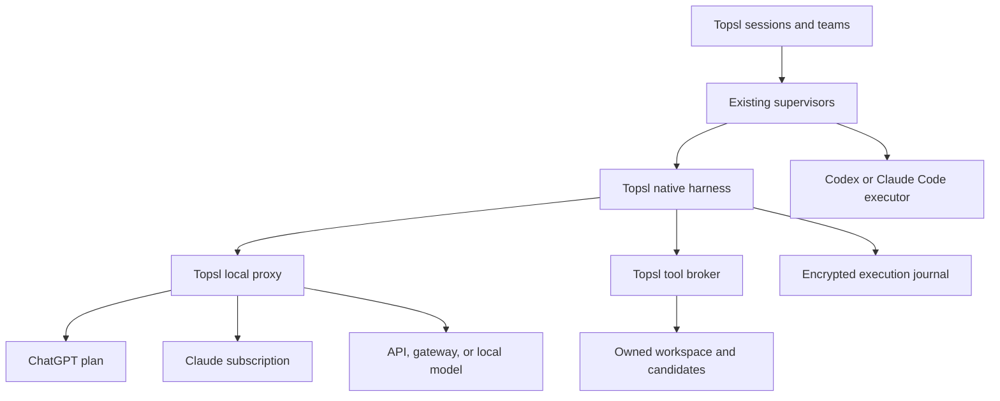

# Topsl Native Harness and Subscription Proxy

**Status:** Agreed plan with an implemented local proxy and native harness. The owner reaffirmed direct Claude-plan sign-in after the first implementation omitted it; the experimental adapter is now implemented with synthetic evidence (§1.2). *Later on 5 November 2026:* native members in coordinator teams, Topsl sessions and Recursive Looping (Phases 6b and 7, R8) are implemented and verified with synthetic routes and stand-ins ([record](Native_Harness_Execution.md#phases-6b-and-7--native-members-in-teams-sessions-and-loops)); both lines are merged on `main`. Live subscription acceptance, the full evaluation corpus and remaining platform/release qualification are still gates. The [execution record](Native_Harness_Execution.md) separates the original evidence from these follow-ups.  
**Saved:** 5 November 2026 (Asia/Shanghai).  
**Reviewed repository baseline:** [2efeed27490bc1b74070125f597eceb738a50f39](https://github.com/Piore-Galore/Topsl/tree/2efeed27490bc1b74070125f597eceb738a50f39).  
**Provenance:** Replaces the implementation direction of the supplied `Topsl_Native_Harness_Plan.md`, incorporating the review and the owner's choices to build a Topsl-owned proxy and a direct Claude model adapter. Provider sources linked below were inspected during the 5 November review. The second review on the same day (§1.1) re-read the OpenAI and Anthropic pages before implementation.  
**Evidence scope:** Source and documentation review, then implementation with synthetic upstreams, a synthetic authorization server, real macOS Seatbelt containment and a real Electron window. No live ChatGPT, OpenAI, Anthropic or Ollama request was made. See [implementation status](Implementation_Status.md) for implemented behavior and dated evidence, and [Topsl design](Topsl_Design.md) for the broader architecture.

## 1. Summary and fixed decisions

Build **Topsl's own local model proxy** so its native harness can use **ChatGPT-plan and Claude Code-plan allowance**, API connections, gateways and local models. Both subscription routes are core delivery requirements.

*Follow-up, 5 November 2026:* the owner explicitly reaffirmed the direct Claude subscription requirement. The earlier implementation's retirement of it is superseded; the built-in experimental adapter implements it, with live acceptance still pending.

Topsl owns context, tool execution, editing, compaction, recovery, and coordination. The proxy handles model requests, protocol conversion, accounts, authentication, and usage attribution.

Confirmed choices:

- Full harness roadmap, MIT licensing, and macOS first.
- A Topsl-owned proxy implemented in TypeScript and packaged with the application.
- Direct model adapters for both subscription routes; the Claude adapter is experimental.
- Native OpenAI/Anthropic API connections, external gateways, and local models.
- Existing Codex and Claude Code executors remain selectable execution engines.
- No automatic fallback from subscription allowance to API billing.

**Provider status:** ChatGPT has a documented integration for eligible applications: open-source and locally hosted apps sign users in and send Responses requests against their plan; paid or remotely hosted apps are directed to an interest form. [OpenAI integration](https://developers.openai.com/siwc/token-sharing-open-source), [sign-in](https://developers.openai.com/siwc/token-sharing-open-source/sign-in). Anthropic's published conditions do not permit a third-party application to offer Claude.ai login, to route requests through Free, Pro, Max or Ultra credentials, or to "collect, store, or intermediate Claude.ai credentials" ([Anthropic, legal and compliance](https://code.claude.com/docs/en/legal-and-compliance), read 5 November 2026).

### 1.1 Review — 5 November 2026

A second review before implementation checked the plan against the provider pages and the repository. Each finding and its resolution:

| ID | Finding | Resolution |
|---|---|---|
| R1 | The initial implementation excluded direct Claude subscription sign-in based on Anthropic's published conditions. That exclusion did not satisfy the agreed dual-subscription requirement. | **Superseded by the owner's follow-up request.** Implemented as the experimental direct Claude adapter in §1.2. Provider support/distribution status and live acceptance remain separate from implementation; there is no silent API or CLI fallback. |
| R2 | The ChatGPT adapter description named "issued client IDs" without the flow. OpenAI documents a specific one. | Implemented as documented: first registration with `client_id=dynamic_agent_client`, `agent_name_hint` and a stable opaque `ext_agent_host_id` (a `urn:uuid:` per profile); PKCE S256; fresh `state` and `nonce`; loopback `http://127.0.0.1:<port>/auth/callback` (1455 first, any free port otherwise); `resource=https://api.openai.com/v1`; scopes `openid profile email offline_access resource.invoke chatgpt.tokens.use.direct`; ID-token signature, issuer, audience, expiry and nonce checks; plan use only when `chatgpt.tokens.use.direct` is granted; rotating refresh without `scope`; revocation through the discovery document's `revocation_endpoint`. |
| R3 | The plan route rejects `max_output_tokens`, `temperature`, `top_p`, `previous_response_id` over HTTP, system-role items and hosted tools, and requires `store:false` and `stream:true`. Models come from `GET /v1/models` as `models[]` with `slug`, `display_name` and `visibility`. [Limitations](https://developers.openai.com/siwc/token-sharing-open-source/preview-limitations), [models](https://developers.openai.com/siwc/token-sharing-open-source/models-and-inference) | The Responses serializer's `chatgpt-plan` profile enforces these and refuses a request that sets an unsupported field rather than dropping it. Only `visibility: "list"` models are offered. |
| R4 | Retry ownership was split ambiguously between "the proxy performs no hidden retries" and "authentication renewal may retry once". OpenAI's error guide also asks for bounded backoff on 503 and a pause on the usage-limit 429. [Errors](https://developers.openai.com/siwc/token-sharing-open-source/errors-and-recovery) | The proxy classifies every failure (`authentication`, `permission`, `quota`, `unavailable`, `invalid-request`, `unsupported`, `route-changed`, `not-found`, `interrupted`, `upstream`) with the exact upstream code, parameter and request ID, and retries only an explicit authentication rejection, once, after renewing the same identity. The harness retries `retryable` failures at most twice on the same route, pauses on `quota` without retrying, and fails on everything else. |
| R5 | "Native requests include the frozen route revision" had no transport. | Headers `x-topsl-route-revision`, `x-topsl-correlation-id` and `x-topsl-attempt-id`. A mismatched revision gets HTTP 409 `route_revision_mismatch` before any upstream request. |
| R6 | `@anthropic-ai/sandbox-runtime`'s `SandboxManager` is a process-global singleton, so it cannot hold independent per-agent policies in one process. | Each contained command, hook and MCP server runs through the package's `srt` program as its own process with its own settings file. |
| R7 | "Credentials never enter renderer state" conflicts with typing an API key into the window. | Electron main reads the key from the clipboard after Topsl's own confirmation, sends it straight to the proxy process and clears the clipboard. ChatGPT sign-in completes in the browser. |
| R8 | Mixed native/vendor teams and Goal/Endless integration require generalizing the `provider: "codex" \| "claude"` unions across role groups, member pins, route selection, readiness and loop policy, and coordinator turns require structured output schemas the harness does not yet carry. | Resequenced: these are Phase 6b and Phase 7 and depend on that refactor. The harness provides the pieces they need (budgets, shared quota waits, no-progress pauses, descendant cancellation). *Resolved later on 5 November 2026:* members are `codex`, `claude` or `native`; a native member binds a proxy route (an `ExecutionBinding` without an installation); the proxy carries a JSON Schema output format on all three protocols; loops wait on a native allowance by quota owner. See the [record](Native_Harness_Execution.md#phases-6b-and-7--native-members-in-teams-sessions-and-loops). |
| R9 | The "no more than twice the scoped-query latency when history grows tenfold" target is sensitive to SQLCipher's page cache at sub-millisecond latencies. | Measured and recorded rather than asserted; the absolute target is asserted. See the [execution record](Native_Harness_Execution.md#phase-8--qualification-checks). |
| R10 | Responses and Chat Completions have no error flag on a tool result. | Accepted: Topsl's failure output text says the call failed. The Messages route keeps `is_error`. |
| R11 | OpenAI's open-source route is for open-source or locally hosted apps. Topsl's package said `UNLICENSED`. | MIT `LICENSE` and [third-party notices](../THIRD_PARTY_NOTICES.md) added; `package.json` declares `MIT`. |

### 1.2 Follow-up — Claude plan sign-in and proxy completion

The owner requested the missing built-in Claude sign-in and reaffirmed the direct adapter. Implemented `claude-plan` / `oauth-claude` in the proxy, browser and clipboard callback handling, credential refresh, subscription-only authorization headers and account-bound receipts. The adapter uses Topsl's own encrypted store and identifies the application as Topsl; it does not read native Claude credentials or emulate a client fingerprint. Successful inference, provider support and distribution eligibility are not inferred from a passing fixture.

Other completed omissions: gateway protocol selection, complete paginated model catalogs, route invalidation on account or adapter changes, durable quota waits, cancelled capacity acquisition, MCP restoration/inheritance with frozen configuration checks, process identity checks before recovery signals, and configured checks bound to the exact candidate being applied. Reconnect verifies the newly authenticated identity; disconnect during sign-in cannot restore credentials afterward. See the [follow-up execution record](Native_Harness_Execution.md#follow-up-claude-plan-sign-in-and-proxy-completion).

Teams, session integration and the associated orchestration refactor are owned by Claude Code in a separate worktree; this follow-up makes no claim that those changes have landed here.

## 2. Architecture and connection contracts

### Ownership

*Follow-up, 5 November 2026:* the Claude subscription branch is restored. *Later the same day:* the supervisor-to-harness edge for teams and loops is wired (R8). The coordinator engine, the session supervisor and the loop supervisor reach the harness through the orchestration driver (`packages/orchestration/runtime-driver.ts`) when a member is bound to a native route; standalone native tasks start from a project's **Native tasks** view.

The proxy returns model text and proposed tool calls. It never executes tools or runs a second agent loop.

Package it as a dedicated Electron utility process, separate from the control service and renderer. Electron main starts and supervises it after vault unlock. Closing the application stops the proxy after bounded cleanup; detaching a window may leave explicitly backgrounded work running.

*Implemented:* `apps/proxy/worker.ts` (bundled as `dist/proxy.cjs`), started by `apps/desktop/proxy-host.ts` after the control service opens the vault; restarted after a crash at most three times in ten minutes.

### Local proxy interface

Provide:

- `GET /v1/models`
- `POST /v1/responses`
- `POST /v1/messages`
- `POST /v1/chat/completions`

Use Responses for native OpenAI connections and Messages for native Claude connections. Chat Completions provides compatibility for gateways and local models. Reject unsupported conversions rather than silently losing tool calls, reasoning controls, images, or continuation state.

Bind to `127.0.0.1` on an available port. Require an application-generated local access token, delivered privately to the control service. Account management uses trusted IPC rather than an unauthenticated HTTP administration endpoint. LAN serving and multi-user hosting are outside the initial release.

*Implemented:* the token is accepted as `Authorization: Bearer` or `x-api-key`; requests with an `Origin` header or a foreign `Host` are refused. `GET /v1/models` answers in the OpenAI or, with `anthropic-version`, the Anthropic shape. Every client protocol reaches every upstream protocol through one canonical model (`packages/proxy/canonical.ts`); provider-private reasoning is refused on any protocol but its own.

Each route identifies:

| Record | Required meaning |
|---|---|
| `Connection` | Account/workspace evidence, credential reference, upstream endpoint, authentication kind, and funding policy |
| `ProxyRoute` | Connection, upstream model, client-facing alias, protocol, adapter revision, and capability evidence |
| `ExecutionBinding` | Immutable engine, route revision, model settings, policy revision, and funding selection for an attempt |
| `RequestReceipt` | Correlation ID, resolved route/account, requested and reported model, terminal outcome, and observed usage |

A model alias must resolve to one connection and funding route. Native requests include the frozen route revision; a changed route is rejected before upstream dispatch. Switching account, model, funding, or engine creates a new attempt from a safe checkpoint.

### Subscription adapters

**ChatGPT plan adapter**

Implement the official registration and sign-in flow, including issued client IDs, PKCE, state/nonce validation, account identity checks, granted permissions, and refresh. Discover models using the selected connection and send inference to the public Responses endpoint. [Registration](https://developers.openai.com/siwc/token-sharing-open-source/sign-in), [models and inference](https://developers.openai.com/siwc/token-sharing-open-source/models-and-inference).

Keep its serializer specific to that route: locally supplied history, streaming, supported tool declarations, and documented field restrictions. Do not substitute API-key credentials or an API-key model catalog. [Preview limitations](https://developers.openai.com/siwc/token-sharing-open-source/preview-limitations).

*Implemented:* `packages/proxy/oauth/chatgpt.ts`, `packages/proxy/jwt.ts`, and the `chatgpt-plan` profile of `packages/proxy/protocols/responses.ts`; details in R2 and R3. A callback with a wrong state is answered and ignored; `access_denied` is recorded as declined with no code exchange; a missing plan-use scope keeps the sign-in and marks plan usage disabled. A usage-limit error marks the connection and pauses every attempt that shares its allowance; Topsl infers no reset time. The live flow has not been exercised against OpenAI.

**Claude subscription adapter — implemented experimentally, 5 November 2026**

The proxy provides browser sign-in, a state-checked callback or clipboard completion, encrypted credentials, account/organization identity checks, serialized token refresh, Messages streaming, tool calls and subscription error handling without launching Claude Code. Its community protocol reference is [CLIProxyAPI at e6e5708e677adb2463d45accdd24bc9fd028ddd8](https://github.com/router-for-me/CLIProxyAPI/blob/e6e5708e677adb2463d45accdd24bc9fd028ddd8/internal/auth/claude/anthropic_auth.go). See [third-party notices](../THIRD_PARTY_NOTICES.md). The Anthropic API-key adapter remains a separate funding route.

### Other connections and compatibility

Add separate adapters for OpenAI API, Anthropic API, compatible gateways, and Ollama. Preserve distinct account catalogs and funding labels.

*Implemented:* `openai-api` (Responses, `https://api.openai.com/v1` only), `anthropic-api` (Messages, `https://api.anthropic.com/v1` only, `x-api-key` and `anthropic-version: 2023-06-01`), `openai-compatible` gateways (selectable Chat Completions, Responses or Messages; https, or http on this computer) and `ollama` (Chat Completions on `http://127.0.0.1:11434/v1` by default, loopback only). Funding labels: plan allowance, API billing, gateway billing, local.

CC Switch and LiteLLM are interoperability references, not runtime dependencies. Qualification must identify the actual upstream credential owner: CC Switch currently excludes official Claude subscriptions from routing, and LiteLLM's documented Claude subscription setup relies on Claude Code providing its token. Neither behavior automatically supplies an independent Topsl Claude connection. [CC Switch routing](https://github.com/farion1231/cc-switch#local-routing--failover), [LiteLLM Claude setup](https://docs.litellm.ai/docs/tutorials/claude_code_max_subscription).

### Credentials and funding

The proxy is the sole writer of a separate encrypted credential database protected by Topsl's vault. Credentials never enter renderer state, prompts, tool environments, ordinary logs, or history exports.

*Implemented:* `connections.sqlite` in the profile, SQLCipher, keyed with an HMAC-SHA-256 derivation of the vault key (`packages/proxy/database.ts`). The derivation separates files and processes, not trust domains: the control service holds the vault key it is derived from. Credential rows carry a revision and are written compare-and-swap.

Use per-account refresh locking and atomic rotation. Disconnect blocks new requests, cancels active transport where possible, and reports whether provider-side revocation is supported.

Subscription, linked credits, API billing, and local execution remain distinct. Share quota ownership across routes when account evidence establishes a shared allowance. Unknown quota or usage stays unknown.

*Follow-up:* routes share a verified Claude account/organization quota owner. ChatGPT registrations for the same verified subject conservatively share a quota owner until a distinct workspace meter is established; a new client registration does not imply more allowance. API keys use their fingerprint. Quota waits persist in encrypted history across restarts. Linked credits have no separate connection kind yet.

The proxy performs no hidden model retries or account rotation. The harness owns retry policy and records every request. Authentication renewal may retry an explicitly rejected authentication attempt once, with the same identity. (See R4.)

## 3. Harness, persistence, and execution behavior

### Compatibility with existing Topsl

Preserve the current supervisors and common workspace preparation. Introduce native bindings throughout runs, agent sessions, assignments, readiness, command schemas, team pins, history, and usage views.

Only vendor bindings require an installation. Replace universal subscription/process requirements with purpose requirements and binding-specific qualification. Keep existing vendor environment checks scoped to vendor execution; native proxy routes use explicit connection settings.

Retain historical identities and unknown values. Do not rewrite old records to invent account, funding, or capability evidence.

*Status, 5 November 2026:* `ExecutionBinding` exists with `engine: "native" | "codex" | "claude-code"` and binds every native attempt; native attempts prepare their copies through the existing candidate capture and materialization. Bindings are **not** yet threaded through runs, agent sessions, assignments, readiness, team pins or the existing usage views (R8). Historical records are untouched.

*Follow-up, later on 5 November 2026:* bindings are threaded through member assignments, team pins, route selection, readiness, rounds, member-session records and loop accounting. A native member's assignment freezes its route's `ExecutionBinding.native` part and records `engine: "native"`; its readiness is `nativeRouteReadiness` (proxy, route, connection, schema capability) with no installation or vendor qualification; vendor readiness is unchanged. Assignments written before have no `engine` and read as their vendor's. Vendor-only workflows (builder–reviewer, parallel specialists, advanced routing presets) keep vendor bindings, and the provider usage views still show vendor usage only; native usage is in each attempt's journal and receipts, and in loop accounting.

### Durable execution

Add an attempt-scoped encrypted journal for frozen requests, settled responses, tool intentions/results, steering, usage, checkpoints, and reconciliation.

Extend protected blob ownership to request manifests, tool output, capsules, and evidence. Authorization and garbage collection must understand these owners; candidate-file references alone are insufficient.

Keep provisional streaming separate from settled history. Batch UI updates and use paginated projections rather than reloading full application state for every event.

Commit events and projection advancement transactionally. Use existing encrypted migration backups, reject incompatible older writers, and restore backups into separate profiles.

*Implemented:* schema 7 (`packages/persistence/migrations/native.ts`) adds `native_journal` (append-only, hash-chained, generation-fenced), `native_projections` and `protected_blob_owners`; migration uses the existing encrypted backup, and schema 6 writers are refused by the existing newer-schema check. Provisional text is sent to the window at most every 100 ms and never journaled; settled events are paged.

### Native step lifecycle

For each step:

1. Claim input under the current generation.
2. Validate binding, grants, budget, and workspace ownership.
3. Freeze tool definitions and compile context.
4. Persist the request manifest.
5. Call the Topsl proxy and display provisional output.
6. Validate and commit the provider's terminal result.
7. Authorize and journal complete tool calls.
8. Execute tools, persist outcomes, and continue or submit evidence.

No tool executes from partial arguments or an unsuccessful response. Vendor tool events remain observations.

Defaults:

- Fifty model requests per attempt, including retries and compaction.
- At most two automatic transient retries on the same route.
- Pause after three consecutive repetitions of the same failed operation without relevant changed state.
- Four concurrent independent reads; one conflicting mutation per workspace.
- Finite tool deadlines, respecting explicitly configured check timeouts.

The proxy and harness must not both retry the same failure.

*Implemented:* `packages/harness/kernel.ts` follows these eight steps with these defaults. An incomplete answer (`length`, `content-filter`) runs no tool and counts as a transient retry. Results return to the model in call order. Arguments are journaled as the model sent them and re-normalized and re-hashed immediately before execution.

### Tools and isolation

Provide bounded reads, listing, repository search, Git inspection, candidate access, expected-base editing, process/check execution, artifacts, and scheduler-mediated delegation.

Use the same admitted tool definitions for model schemas and dispatch. Recheck normalized arguments, implementation revision, grants, workspace identity, and revocation immediately before execution.

Use `@anthropic-ai/sandbox-runtime@0.0.81` behind Topsl's macOS environment interface. Separate helper processes hold independent policies; agents must not share mutable sandbox-manager state. Configure explicit filesystem restrictions, task-local temporary storage, minimal environments, and granted network destinations.

Apply containment to shell descendants, executable hooks, local MCP servers, and extension helpers. Missing required containment blocks execution. Existing task authorization remains reusable.

Native edits enter the ordinary candidate lifecycle. Checks and reviews bind to the exact candidate; acceptance and application to the original folder remain separate.

*Implemented:* `read_file`, `list_directory`, `search` (ripgrep, else a bounded scan), `git_log` and `git_show` (committed history of the original folder only, with hooks, pagers, external diffs and text conversion off), `workspace_changes`, `edit_file`/`write_file`/`delete_file` (expected sha256; Git metadata and symbolic links never written), `run_command`, `run_check`, `record_artifact`, `load_skill`, `propose_memory`, `delegate` and `integrate_child`, plus admitted MCP tools. Containment (`packages/harness/sandbox.ts`): writes only to the attempt's copy (edit attempts) and its temporary folder; the home folder and other temporary folders unreadable except the attempt's own roots and toolchain folders; well-known credential folders always denied; no network unless granted; a minimal environment that refuses credential-like variables; the whole process group killed on timeout or stop. Configured checks now capture the workspace before and after running and record their immutable candidate revision. Application requires each configured check's latest result to pass on that exact revision; missing, failed, stale or mutating checks block application. Candidate access beyond the attempt's own copy and an automated review binding remain for the wider integration. A finished edit attempt is captured as a candidate; applying it to the folder needs a clean Git folder that still matches the baseline, and Topsl's own confirmation.

### Recovery and context

Reconstruct execution from durable operational records, not summaries.

- Retry safe reads when appropriate.
- Reconcile expected-base edits against recorded input/output hashes.
- Retain process ownership until termination or reconciliation is established.
- Preserve uncertain external effects and block conflicting replay.
- Distinguish proxy failure, provider rejection, interrupted streaming, and tool uncertainty.

Implement token-aware context budgeting and compaction before long native tasks. Preserve policy, user constraints, project instructions, accepted state, and complete tool exchanges. Provider-private continuation stays scoped to its original route.

Publish compaction capsules only against a still-valid event range. Preserve concurrent steering and original history. Local limits control admission; unavailable output caps or delayed usage measurements cannot become promises of exact spending limits.

*Implemented:* after a service restart every unfinished attempt is claimed under a new generation (a writer still holding the old one is refused), a request without a settled answer is recorded as interrupted, a command that was running is signalled only if its recorded macOS process identity still matches, and its effects are left uncertain, and the attempt is left paused for the owner. On resume, open reads run again and recorded edits are reconciled by content hash. An uncertain call blocks resume until the owner records whether it took effect. Compaction summarizes only events up to a complete user turn that leaves the latest two exchanges verbatim, keeps every owner message word for word, and is discarded if another capsule was published meanwhile. Token counts are estimates (about 3.5 characters per token) used for admission and compaction only.

### Teams and extensions

Separate inference reservations from managed-process capacity and workspace leases. Keep the default global concurrency of two.

Waiting parents release inference capacity before children run. Writers retain workspace ownership until effects settle. Use separate write copies and one integration owner. Default delegation depth is two, with four active descendants per root, further constrained by root budgets.

Deliver fresh, task-package, and visible-context fork delegation, progressive skills, admitted MCP tools, isolated hooks, and scoped memory. Learned durable instructions require acceptance; preserve the current Codex-memory setting.

Goal and Endless continuation remains with the existing loop supervisor. Stop cancels descendants and future launches. No-progress and quota-exhausted episodes wait instead of immediately restarting.

*Implemented in the harness:* a resource ledger with an inference pool of two held only during a model request, a separate process pool, one mutation slot per workspace and shared quota waits; the three delegation modes with separate write copies, a parent that alone integrates, depth two, four active descendants, and children funded from the root's remaining requests; skills listed by name and description and loaded on demand from `.agents/skills`, `.claude/skills` or `skills` in the project; MCP servers admitted against a snapshot of tool names and schema hashes, run contained, restored on resume only with their original server configuration, and inherited by children in separate instances; missing historical configuration or changed tools refuses restoration; before/after tool hooks run contained with a read-only workspace and no network (exit 2 refuses a call; any other failure refuses too); memory proposals that reach later tasks only after acceptance. The Codex memory setting is untouched. *Not implemented:* mixed native/vendor teams and Goal/Endless integration with the loop supervisor (R8).

*Implemented later on 5 November 2026 (synthetic evidence):* mixed teams. A coordinator, session or loop member can be pinned to a native route beside vendor members, and runs as one bounded episode (the default 50 requests) in its own Topsl-owned copy with read, and for implementation edit, tools only; the driver captures its candidate against the task's permitted outputs. A member waiting on its allowance, paused for no progress or paused by the owner waits; it is never replaced, and resuming the allowance continues every member on it. An executing native member holds one slot of the shared capacity. Goal and Endless runs stay with the loop supervisor: an iteration waits before starting while a native allowance it needs is exhausted, shows quota and no-progress waits during an iteration, and Stop cancels native members and their descendants. Member turns get no delegation, commands, network or MCP tools yet.

## 4. Delivery phases

| Phase | Delivery and exit criterion | Status, 5 November 2026 |
|---|---|---|
| **0 — Baseline and adapter evidence** | Record repository/protocol baselines, MIT licensing, upstream notices, and qualification fixtures. Pin the community Claude source revision and document its support status. | **Done**, with the Claude community source pinned in the follow-up (§1.2). Baseline 2efeed2, provider pages re-read, MIT license and notices, synthetic protocol fixtures. |
| **1 — Topsl proxy and subscription prototypes** | Package the proxy process, authenticated loopback interface, encrypted credential store, and both subscription adapters. Demonstrate streaming and a tool-call/result round trip for each route using a minimal client. | **Both adapters implemented with synthetic evidence.** Built-in Claude sign-in controls were exercised in Electron with browser opening intercepted. Live sign-in/inference for either provider remains unverified. |
| **2 — Compatibility and persistence** | Introduce bindings, common preparation, journal indexes, artifact ownership, and resource reservations. Existing vendor workflows and historical profiles remain readable. | **Mostly done.** Bindings for native attempts, schema 7, blob ownership, resource reservations, migration tests from schemas 2–6; *later on 5 November 2026* threaded through assignments, team pins, rounds, sessions and loops. Vendor runs keep their own records; the provider usage views do not yet show native usage. |
| **3 — Native kernel and connections UI** | Deliver read-only tools, context budgeting, compaction, steering, replay, and account/model/funding selection. Complete a repository investigation through each subscription route. | **Done with synthetic evidence**: Connections page and Native tasks view; read/tool work through synthetic ChatGPT-plan, Claude-plan, Anthropic API and gateway routes. |
| **4 — Editing and execution** | Qualify macOS containment, process recovery, patches, candidates, checks, and review/application controls. Complete native coding tasks through both plans. | **Implemented locally on one Mac with synthetic models**: real Seatbelt containment, editing and candidate application, with configured checks now required on the exact candidate. Automated review binding and live dual-plan acceptance remain. |
| **5 — APIs and interoperability** | Qualify native API connections, external gateways, all three client protocols, and Ollama. Preserve funding identity through every conversion. | **Done with synthetic upstreams.** No live API, gateway or Ollama qualification. |
| **6 — Extensions and mixed teams** | Deliver skills, MCP, hooks, memory, delegation, and mixed native/vendor teams. Verify pins, capacity waits, isolated writers, and integration ownership. | **Done with synthetic evidence** (6b later on 5 November 2026): pins to native routes, capacity, members' own copies, the driver's capture and integration. Member turns do not yet get delegation, MCP or hooks. |
| **7 — Goals and Endless** | Integrate bounded episodes, shared account budgets, quota waits, no-progress handling, and descendant cancellation. | **Done with synthetic evidence** (later on 5 November 2026): bounded member episodes, waits by quota owner before and during iterations, no-progress waits, native usage in loop accounting, Stop cancelling native members. Quota waits were kept in memory in this work; after the merge with §1.2 the harness ledger stores them in encrypted history, untested across a restart during a member's wait. |
| **8 — macOS qualification** | Complete evaluations, UI journeys, load tests, packages, recovery documentation, and route-specific evidence. | **Started**: a native Electron journey (all eight default journeys pass), the journal latency benchmark, and the macOS package checks in the execution record. Evaluations with live models, load tests at 120 sessions and 60 goals, and route-specific live evidence remain. |

**The dual-subscription objective requires both plan routes to complete native harness tasks.** Synthetic tests cover both adapters; live account acceptance remains open. API execution or a vendor-agent run does not count as a substitute.

Windows and Linux native execution remain gated for later platform qualification. Containment reports unavailable there, so native commands, hooks and MCP servers do not run; read-only and edit tools still do.

## 5. Acceptance and documentation

Required tests include:

- Both subscription routes complete read → tool call → result → edit → check → candidate, without launching Codex or Claude Code for inference. Keep synthetic and live evidence separate.
- Requests preserve connection, account, model, route revision, and funding through streaming, retries, compaction, and delegation.
- Expiry, concurrent refresh, revoked credentials, declined sign-in, unavailable models, and mid-stream quota failures produce accurate states.
- Protocol conversion preserves tool IDs/results and rejects unsupported features.
- Proxy restart, service restart, and crashes around tool dispatch do not duplicate effects.
- Route changes cannot silently redirect an active attempt.
- Two accounts remain isolated; routes sharing one account share quota ownership.
- Credentials are absent from renderer payloads, tool environments, logs, and exports.
- Workspace, network, symlink, descendant-process, and concurrent-policy containment tests pass.
- Compaction, cancellation, capacity exhaustion, candidate retention, and old-profile migration behave correctly.

Evaluate investigation, bug fix, refactor, test diagnosis, review, cross-provider handoff, compaction, and restart tasks, with three repetitions per representative configuration. Record provider/model differences and unknown usage.

On the reference Mac, target p95 below 100 ms for scoped queries at 120 sessions, 60 goals, and 100,000 journal events; below 250 ms from received provider chunk to visible UI output; and no more than twice the scoped-query latency when history grows tenfold. Measure provider latency separately.

Run focused tests per phase, `npm run check` at integration boundaries, affected Electron journeys, and macOS package verification. Keep fixture, live subscription, UI, and packaged evidence separate.

The [execution record](Native_Harness_Execution.md#acceptance-coverage) maps each bullet above to the tests that cover it, all synthetic or local, and lists what none of them covers.

This file is the canonical plan. Update the existing [design](Topsl_Design.md) and [implementation-status](Implementation_Status.md) documents during implementation, and revise [README](../README.md) and release claims only when supported by evidence. Preserve source provenance, label the Claude adapter as experimental and distinguish implementation from live qualification, verify documentation links, and run `git diff --check`.
