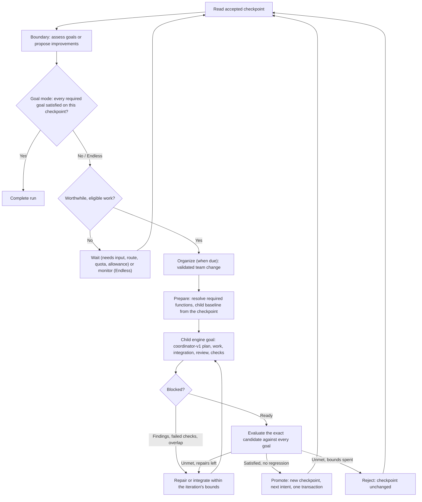

# Recursive Looping (experimental)

**Status (19 October 2026):** implemented behind `experimental.recursiveLooping` (off by default). It is **implemented, fixture-tested, service-tested with a scripted Codex process and desktop-tested in an actual Electron session against that stand-in**. A bounded **Codex-only live pilot** completed one Goal loop through the real app with Codex CLI 0.163.0 ([§16](#16-live-pilot-19-october-2026)); that is not cross-provider, packaged or repeated-run qualification, so RL-7 remains open. The release labels in [§12](#12-phase-status) stay separate.

This is the repository's canonical description of the feature. It was built from the owner's *Topsl — Recursive Looping* specification (reviewed 18 October 2026 against `main` at `b3e5a18`), which proposed placing the canonical document here and updating the existing documents instead of copying the specification into each. It extends the [coordinator feature specification](Coordinator_Feature_Specification.md) and the [coordinator teams delivery](Coordinator_Teams.md); arbitrary N-member roles, separately attributed contributions, one authoritative service decision and the existing task, attempt and lease machinery are kept. Where this implementation departs from that proposal, [§13](#13-deviations-from-the-proposed-specification) says how and why.

## 1. What it does

A loop run is a persistent operating mode for one project. A deterministic **Loop Supervisor** ([loop-engine.ts](../packages/orchestration/loop-engine.ts)) sits above the coordinator engine ([engine.ts](../packages/orchestration/engine.ts)) and repeats iterations against one shared, accepted project checkpoint.

| Mode | You supply | The run | It finishes when |
| --- | --- | --- | --- |
| **Goal loop** | One or more goals | Interprets acceptance criteria, assesses the accepted checkpoint, organizes the team, delegates, verifies, repairs and promotes, goal by goal | Every current required goal has valid evidence on the same accepted checkpoint |
| **Endless** | The project and optional priorities | Proposes improvements, picks a worthwhile one, implements and verifies it, promotes, reassesses | You stop it. "Nothing worthwhile now" is monitoring, never completion |

In both modes the coordinators decide which roles are active, how many members each has and which observed models fill Auto slots, including the coordination team itself, except for every field you locked. "Recursive" is a durable state machine with bounded rounds; a child engine goal never starts a loop.

## 2. Using it

1. In a project's **Coordinator** view, choose **Run mode: Single goal / Goal loop / Endless**. *Single goal* is the existing team conversation. Switching between Goal loop and Endless keeps the text you typed and shows that mode's runs. Choosing a run in the **Run** picker shows that run at once. The loop modes carry an **Experimental** label; the first visit offers **Turn on experimental Recursive Looping** (`loop-feature-set`).
2. Describe the goals (Goal loop) or what to improve and its priorities (Endless). Optional: one required check, whether it runs automatically on each candidate (on the host, with your OS permissions, not a sandbox), slots kept free for your direct work, and a run allowance in member turns. **Create run** records the run without starting it.
3. **Review and start** opens a native dialog that states what the run will do. Confirming it records the run's authority once; ordinary iterations are not approved one by one.
4. While it runs, the header always shows **Pause / Resume** and **Stop**. With the feature turned off, the loop view is replaced by the turn-on prompt and an **Existing runs** list that keeps **Stop** for every run that has not stopped (see [§10](#10-lifecycle-and-durability) for the disable policy). You can add, edit, reprioritize or remove goals, lock a role's member count, keep a role's current team, return a lock to Auto, or steer by message. The same membership phrases as the team conversation work there, plus "Do not use provider X", "Always keep an accessibility role" and "Use exactly four active roles"; editor and message save the same override. An active-role count must be a whole number from 3 to 64 and is refused with the reason otherwise: the required functions need three distinct purposes (coordination, implementation and review), and 64 matches a role's member-limit ceiling.
5. **Accepted checkpoint** shows the accumulated changes since the run started. **Publish to folder…** writes them into the project folder after a native dialog listing the exact files. Nothing is committed, staged or pushed. **Export copy** writes the checkpoint to a Topsl-owned folder.

Commands ([loop-commands.ts](../packages/domain/loop-commands.ts)): `loop-feature-set`, `loop-query`, `loop-inspect`, `loop-timeline`, `loop-create`, `loop-start` (native confirmation), `loop-goals-update`, `loop-policy-update` (native confirmation when it widens execution), `loop-override-set`, `loop-override-release`, `loop-control`, `loop-message`, `loop-checkpoint-export`, `loop-publication-preview`, `loop-publication-apply` (native confirmation) and `loop-publication-reconcile`. Assessment, topology commits, iteration admission and promotion have no public command; only the supervisor performs them.

## 3. Architecture



| Layer | Owns |
| --- | --- |
| Loop Supervisor ([loop-engine.ts](../packages/orchestration/loop-engine.ts)) | Runs, goals, iterations, decision rounds, assessment and evidence validation, topology, promotion, waits, controls, cumulative accounting, recovery |
| Protocol ([loop-contracts.ts](../packages/orchestration/loop-contracts.ts)) | `recursive-loop-v1` envelopes per stage, the output-schema registry, bounded prompts, fingerprints and prioritization |
| Adaptation ([adaptation.ts](../packages/orchestration/adaptation.ts)) | Outcome aggregation, task-family ranking with uncertainty, the change policy and revert rule |
| Checkpoints ([loop-checkpoints.ts](../packages/orchestration/loop-checkpoints.ts)) | Publication base and owned checkpoint copies, child baselines, the run protocol, publication increments, retention, usage coverage |
| Coordinator engine ([engine.ts](../packages/orchestration/engine.ts)) | Each iteration's child goal: rounds, plans, work, integration, review, checks; unchanged machinery with the [§11](#11-coordinator-engine-changes-rl-0) prerequisites |
| Runtime driver ([runtime-driver.ts](../packages/orchestration/runtime-driver.ts)) | Attempts, copies, capture, integration and checks over the existing runtime, leases and concurrency budget |

Each iteration has one child engine goal (more only after a restart of preparation), created with a pre-generated ID, the run's loop binding (active roles, adaptive settings, owner overrides, provider exclusions, outcome ranking), function bindings and a preset baseline. Child goals are not listed in the ordinary goal list or routed by conversation messages. A child reaching *awaiting acceptance* or *completed* is an input to the parent's evaluation, never the parent's completion rule.

### Records

All are additive document kinds in the encrypted store, scoped by project and indexed by run (the run ID is written to the indexed conversation column), so a run's records page without a full scan.

| Kind | Meaning |
| --- | --- |
| `loop-run`, `loop-active` | The run (lifecycle state, desired control state, generations, revisions, accepted checkpoint) and the index of runs the scheduler visits |
| `loop-goal`, `loop-goal-assessment` | Versioned goals with criteria and provenance; assessments bound to a target (checkpoint or exact candidate digest), goal version and protocol revision |
| `loop-iteration`, `loop-intent` | Iterations with contract, frozen assignments and failure class; the next-iteration outbox entry, one per boundary |
| `loop-checkpoint`, `loop-promotion`, `loop-checkpoint-evidence` | Immutable accepted content, the machine promotion that created it, and check evidence on an initial checkpoint |
| `loop-topology`, `loop-adaptation`, `loop-outcome` | Organization revisions with purpose bindings, every proposed, committed, rejected, kept, reverted or recovery decision with reasons and dissent, and per-member outcomes |
| `loop-override`, `loop-policy`, `loop-usage` | Owner locks with provenance and effective boundary, the run policy with its confirmed authority digest, cumulative accounting |
| `loop-round`, `loop-contribution`, `loop-decision` | Decision rounds with frozen electorate and expected revisions, attributed contributions with protocol provenance, the merged decision |
| `loop-opportunity`, `loop-wakeup`, `loop-check-authorization`, `loop-publication-cursor`, `loop-event` | The improvement backlog, persisted wakeups, machine-attributed check authorizations, the publication receipt, and the attributed event timeline |

## 4. The `recursive-loop-v1` protocol

Every loop decision turn runs on the read-only coordinator route (`coordinator-contribution`) with `protocol: { kind: "recursive-loop-v1", stage, mode }` on the member turn and runtime execution. `purposeOutputSchema(purpose, protocol)` ([contracts.ts](../packages/orchestration/contracts.ts)) is the one registry for provider schema enforcement and parsing. No production adapter currently declares the `review-output-schema` capability, so no schema is sent to a provider: the prompt is the contract the model sees, and the parser is the gate. The prompt therefore shows one complete example of every permitted decision (`decisionExamples`, validated against the schemas by [recursive-loop-contracts.test.ts](../tests/recursive-loop-contracts.test.ts)), with the real goal and criterion IDs filled in: an ordinary `coordinator-v1` contribution keeps its task-plan schema; a loop turn gets its stage's envelope, emitted with `anyOf` because strict providers reject `oneOf`. A response for another protocol, stage or mode is invalid; one naming other revisions is stored as stale history.

| Stage | Permitted decisions |
| --- | --- |
| `boundary` (Goal) | `assess_goals`, `plan_iteration`, `request_wait`, `propose_goal_completion` |
| `boundary` (Endless) | `propose_opportunity`, `select_opportunity`, `plan_iteration`, `request_wait` |
| `organize` | `reconfigure_team`, `request_wait` |
| `evaluate` | `assess_goals`, `request_repair`, `propose_integration`, `propose_promotion` |

An envelope repeats the exact expected run ID, iteration, control and authority generations, checkpoint ID and digest, goal-set, topology, policy and override revisions, the round's input digest and an idempotency key, and carries one to four decisions. A zero-work outcome (`request_wait` alone) is valid; the non-empty action rule stays for an executable child plan. Models propose; only the supervisor commits.

Prompts are bounded: current goals and criteria, for evaluation the contents of up to ten changed files of the candidate (8,000 characters each), because a read-only turn cannot be relied on to read its copy, the active organization with your locks, observed models (organize only), the backlog and ideas rejected at this content, evidence IDs for the target, the last five iteration results, changed files, and, after a coordination team change, a versioned handoff package. The exact context is frozen with the round.

## 5. Goal mode

- **Goals** are split from the request (lines, or clauses that start with an action; run and membership instructions are excluded) and keep their original wording, version, required flag (default required), priority, dependencies, constraints, status (`unassessed`, `in_progress`, `satisfied`, `regressed`, `blocked`, `cancelled_by_user`), last assessment and provenance. A removed goal is `cancelled_by_user`, never accomplished.
- **Criteria.** Your criteria come first. A goal without criteria is interpreted at a boundary (the coordinators propose criteria, recorded as theirs and editable), and is never targeted before it has criteria. Each criterion names its verification: `check` (one of the run's protected checks), `review`, `artifact` (an information result) or `inspection` (cited files that exist in the target, or cited evidence IDs).
- **Evidence.** Coordinators' claims are merged conservatively: a criterion is met only when every assessing member says met *and* the service finds the required evidence on the exact target. A claim without evidence is recorded as `missing-evidence` and counts as unmet.
- **Completion** requires every current required goal to have a satisfied assessment for its current version on the accepted checkpoint (or on the promoted candidate with the same content), current passing evidence for every protected check on that content, no iteration in flight, and unchanged goal-set, control, policy and checkpoint revisions at the final transaction. Optional goals never keep a run open.
- **Regression.** Evaluation assesses every goal on the candidate. A goal satisfied at the parent that the candidate breaks becomes `regressed`, and the iteration repairs before it can promote; if it cannot, the candidate is rejected and the head is unchanged.
- **Conflicts** between goals are recorded on both; neither is deleted or weakened, and conflicting goals are not advanced together.
- **Fairness and repetition.** Required goals first, then priority; equal priorities rotate by fewest attempts. After `maxApproachesPerTarget` (default 3) non-transient rejections at the same content a goal waits for your direction; a repeated approach at the same content is flagged as needing a materially different approach.

## 6. Endless mode

Each boundary refreshes the backlog. An opportunity records the observed issue, area, expected benefit, baseline evidence, acceptance conditions, scope, dependencies, why now, approach and scores. Its fingerprint ignores wording order but keeps numbers. The priority score is a transparent formula: `(0.5·benefit + 0.25·urgency + 0.25·confidence) · (1 − 0.5·regression risk) · (1 − 0.4·effort)`, plus 0.1 when it matches a priority. Only opportunities at or above `opportunityThreshold` (default 0.25) are eligible.

An opportunity rejected at the same content is not proposed again; a changed project makes it eligible again. With nothing eligible the run **monitors**: it schedules a persisted wakeup with backoff (300 s initially, doubling to at most 6 h; a policy whose `initialSeconds` exceeds `maxSeconds` is refused, and a policy stored before that check waits at most `maxSeconds`) and wakes sooner when the accepted checkpoint, goals, policy, overrides, provider routes or the project folder's Git `HEAD`/index change.

## 7. Organization

- **Catalog versus topology.** The role catalog is every defined role. A topology revision selects active roles, their adaptive settings (count, per-slot observed models, collaboration, execution width) and a binding for each function: coordination, evaluation, implementation, integration, review, information. Each function needs a fixed execution purpose; a label cannot turn an implementation result into a review.
- **Bootstrap.** The service chooses the first organization (coordinator, implementer, reviewer and researcher, all Auto) with the shared eligibility resolver and records it as a bootstrap decision with limited evidence. No provider or model is mandatory. The first organize round may replace it without waiting for the dwell period.
- **Changes.** Coordinators may create, activate, retire, split or merge roles, set members (observed, qualified models only) and collaboration, and rebind functions. The supervisor validates each proposal against your locks, member limits, capability and purpose compatibility, required functions, active-role-count and role-presence overrides, and the change policy, and either commits it or records concrete rejection reasons. It never rewrites a requested roster.
- **Change policy** (policy fields, proposed defaults, not measured optima): routine changes wait `dwellIterations` = 3 evaluated iterations; at most `maxRoutineOperations` = 2 operations while evidence is weak; untried models at most `explorationShare` = 10% of the window's turns; swap-backs and recurring organizations are rejected without a trigger. Triggers (unavailable unpinned route, invalid output, verification failures, exhausted repairs, no progress, new requirements, your steering) allow an immediate change. A routine experiment that did worse than its predecessor is reverted automatically. As implemented, only a routine experiment whose promotion rate falls to zero after enough outcomes is reverted; a smaller decline is kept ([test decisions](testing/TEST-DECISIONS.md#documentation-contradictions-found)).
- **Coordination handoff.** A change to the coordination team is decided by the current team's frozen electorate under its decision rule (members whose proposal differs endorse or challenge the leading proposal). Committing it advances the authority generation, so decisions made against the old generation cannot commit, and the incoming team receives the handoff package. If an unpinned team returns no valid decision, the supervisor replaces the failed members from the remaining eligible ranking, at most twice per iteration; exact pins wait or use only their authorized fallback.
- **Ranking.** Outcomes record model, provider, installation revision, effort, role, function and binding revision, task family, difficulty, checkpoint basis, cohort, contribution validity, iteration result and usage coverage. Ranking compares within a task family when it has data, weights harder accepted work up, and leaves unknown models at the prior's lower estimate in the cold-start order. It orders models by a conservative lower estimate, not the average: a valid contribution to an iteration that failed earns partial credit, and on a harder task it counts as less evidence, which lowers the average less but widens the uncertainty. So a failed hard iteration can rank a model below the same failure on an easy one until more outcomes arrive; this is intended (owner decision, 20 October 2026). Statistics belong to a provider and model together, so the same model ID on two providers is ranked from each provider's own outcomes; the ranking handed to member selection lists model IDs, each at the position of its best eligible provider. Low data is shown as low confidence.
- **Your locks win.** Owner settings carry user authority at every scope (project role defaults, run overrides, goal settings); adaptive settings and any automatic revision fill only fields no owner layer set ([membership.ts](../packages/orchestration/membership.ts)). An exact roster is closed; a required-members roster keeps its pins and may gain Auto slots. A role carrying your settings or pins cannot be retired, split or merged automatically. Overrides take effect at the next iteration boundary; a provider exclusion also restarts current rounds that use that provider.

## 8. Checkpoints, verification, promotion and publication

- **Publication base and checkpoint 0.** Starting captures the trusted Git folder once (Git-tracked files with their working-tree content; untracked files are not captured unless approved; nothing is committed, stashed or discarded) and writes an owned copy as checkpoint 0. The capture policy is shown as the run's capture conditions.
- **Child baselines.** Each iteration materializes the accepted checkpoint into a new owned folder and captures it again under the child goal's workflow identity, with the checkpoint as its content base and an equal file digest. No candidate record is mutated, and the original folder is never captured again.
- **Protected protocol.** The run's checks are bound to checkpoint 0. Each child binds them again at its baseline; a child whose protected test, configuration or script inputs differ from the run's protocol is rejected, so a candidate cannot weaken the original obligations. New test files strengthen later bindings.
- **Checks.** When the run policy grants automatic checks, the supervisor previews and runs the exact definitions on the exact candidate (and once on checkpoint 0) and records a `loop-check-authorization` attributed to `loop-policy`, bound to the plan digest computed by the service and marked `host-user-permissions`, not sandboxed. Without the grant, checks wait for your ordinary confirmed run. A `failed` check is repaired; `error`, `unavailable` or `skipped` is a visible verification wait and never a pass.
- **Repair and integration.** Within the iteration's bounds the child goal is repaired for blocking findings, failed checks or unmet criteria, using the role bound to the implementation function. Overlapping changes go to an integration task that sees every contributor's version and must keep their work; the result is reviewed and checked again.
- **Promotion** (`loop-promotion`, by `loop-policy`) requires a quiescent child, a satisfied review of that candidate, current passing checks, an unchanged protocol, an assessment of the exact candidate digest and an unchanged parent checkpoint and control generation. It records the checkpoint, the promotion, the iteration result, goal statuses and the next intent in one transaction with compare-and-swap on the parent. A replayed promotion settles once; duplicate boundary events admit one child. The same transaction marks the iteration's settlement as pending (`settlementPending`, also set by a rejection); settling the child goal and finishing the iteration (outcome records, token totals, reclaim) clear it. If a crash interrupts those steps, the next tick completes them before anything else, so the promoted child reaches `completed` with its `loop-policy` disposition and the iteration gets its outcome records. Owner acceptance (`orchestration-accept`) is not used and keeps its meaning.
- **Publication** (`loop-publication-apply`) is separate. The first publication needs a clean folder that still matches the publication base; later ones need the folder to match the last receipt exactly (same Git revision, only Topsl-written paths changed, each with its recorded hash) and write only the next increment. An intervening edit is refused. After you commit the published files, **I committed the published files** (`loop-publication-reconcile`) accepts the new revision only when every published path is unchanged; otherwise a newly reviewed basis (a new run) is needed. An interrupted write is recorded as uncertain and not repeated. A run's publication and reconciliation steps run one at a time, and a repeated command ID that arrives while the first is still running waits for it and shares its outcome, so two concurrent confirmations of the same checkpoint write once: the second is refused as already published.
- **Retention.** At each iteration end, owned child baselines, assembled dependency baselines and rejected candidates' copies are reclaimed; the head and pinned checkpoint 0 are kept, and immutable blobs remain for rematerialization.

## 9. Authority and resources

The run policy ([recursive-loops.ts](../packages/domain/recursive-loops.ts)) holds allowed work, provider exclusions, the protected checks and the automatic-check grant, automatic organization, per-iteration bounds (200 turns, 20 tasks, 2 repairs, 3 approaches by default), run and rolling member-turn allowances, adaptation and monitoring parameters, the direct-work reserve (1 slot by default) and the restart policy. Starting it, and any update that grants automatic checks or lifts a provider exclusion, needs the native dialog's digest; a model or window cannot supply it.

Child grants are bounded by what the run and rolling allowances leave, so a new child never resets accounting; a new iteration is not admitted with fewer than 4 turns left, and the wait says it is not completion. Before admitting work the supervisor checks the runtime-reported quota (`allowance-snapshot` limit reached) and your provider budgets, keeps the reserve free for direct work, and admits at most one iteration per tick across runs, least recently admitted first. Token usage is cumulative across children; unreported usage stays unknown, never zero. Each charge writes the usage record and the iteration's turn count in one transaction, so a crash can neither lose nor repeat it. The rolling history keeps every turn of the last 31 days (the longest window): adjacent entries are merged while the merged span is at most 1/64 of its age, and a merged entry is dated by its latest turn, so a window may count a turn slightly longer than strictly due, never shorter.

## 10. Lifecycle and durability

Lifecycle states: `active`, `monitoring`, `waiting`, `paused`, `suspended`, `stopping`, `stopped`, `completed` (Goal mode only), separate from the desired state (`running`, `paused`, `stopped`) and the control generation.

- **Stop** persists the new generation first, cancels wakeups and intents, stops child goals (interrupting attempts and fencing checks), interrupts open decision rounds and reports `stopped` only after every owned execution is observed quiescent; until then it is `stopping` and names what has not confirmed. Late results are archived as stale. "Stop everything" in the project stops its runs too, whether or not Recursive Looping is turned on.
- **Pause / resume** fence and later revalidate with a new generation; a paused round restarts with fresh inputs.
- **Turning the feature off** (decided 19 October 2026, resolving [D-01](testing/TEST-DECISIONS.md#high)) pauses every started run that is meant to run, at once from `loop-feature-set` and on every later tick while the flag stays off (for example after a restart or a flag set outside the app). The pause is the owner's Pause: a new generation fences dispatch, wakeups are cancelled, owned child goals are paused and open decision rounds are interrupted. No iteration is admitted, no wakeup fires and restart does not auto-resume while it is off; settling work that already committed still finishes. **Stop** and **Pause** stay available; **Resume**, creating, starting and steering need the feature on. Turning it back on resumes nothing by itself. A run is paused rather than stopped so that turning an experimental flag off never discards a run's state. A member turn whose interruption the runtime cannot confirm is recorded as uncertain, so a later Stop stays `stopping`, naming it, until you reconcile that turn (`run-reconcile`), as after a manual Pause. Since 20 October 2026 a Claude turn that Topsl interrupts ends `interrupted`, as a Codex turn does, when Claude Code exits on the interrupt and its process group is observed gone; it stays uncertain when Claude Code ignores the interrupt or ends some other way ([`claude.ts`](../packages/providers/claude.ts)). Before that, the Claude route reported every cancelled turn as uncertain. Interrupting a live Claude Code turn has not been tested; this is established against stand-ins only ([Implementation status](Implementation_Status.md#claude-structured-route--19-october-2026)).
- **Quit and restart.** Closing the service suspends active runs. On start, recorded launches are adopted, the project and the accepted checkpoint's content digest are revalidated, and a suspended run resumes only if its policy selected automatic resume; otherwise its child work is paused until you resume. A stop intent is never overridden by a wakeup, quota renewal or restart.
- **Sleep.** A gap of more than ten minutes between ticks is recorded; due wakeups fire once.

## 11. Coordinator engine changes (RL-0)

These apply to ordinary coordinator goals too and are covered by [loop-prerequisites.test.ts](../tests/loop-prerequisites.test.ts) and the existing suites:

- Coordinators see each role's **resolved** roster (members that can run now, with how many cannot), the same resolution that executes the plan. A partitioned plan made for another roster blocks with a replan request; a required member is never trimmed to fit partitions.
- Rounds freeze role-definition revisions, the loop topology revision and any dependency bundle; a changed definition makes a decided but undispatched round stale.
- Plan actions must go to a role whose purpose produces the task's output contract, and not to a role with no runnable member.
- **Dependency handoff.** A dependent task receives a typed bundle of its predecessors' results; a code task starts from an assembled baseline containing its predecessors' changes, and final integration uses the ancestry so a later result supersedes, never conflicts with, its base.
- Coordination, review and repair use function bindings instead of fixed role IDs. Repair can be driven by failing checks or unmet criteria, and overlapping changes can be integrated by an integration task. Owner authority comes before scope in settings resolution.

One existing behavior changed as the specification required: the coordinator prompt previously listed a role's configured minimum (for example one implementer) while execution resolved the Auto count (two for a complex goal). Three scripted test plans that encoded the old count now read the resolved roster from the prompt.

## 12. Phase status

| Phase | Status | Evidence |
| --- | --- | --- |
| RL-0 Contracts and prerequisites | Implemented, fixture-tested | [loop-prerequisites.test.ts](../tests/loop-prerequisites.test.ts), [recursive-loop-contracts.test.ts](../tests/recursive-loop-contracts.test.ts), existing orchestration suites |
| RL-1 Durable iterations and cumulative state | Implemented, fixture- and service-tested | CP-01–CP-04, ST-04–ST-06; [loop-checkpoints.test.ts](../tests/loop-checkpoints.test.ts) on a real Git folder; [loop-service.test.ts](../tests/loop-service.test.ts) |
| RL-2 Automatic execution within policy | Implemented, fixture- and service-tested | VF-01–VF-07, AU-01–AU-04, CP-05/CP-09; service-level publication |
| RL-3 Goal mode | Implemented, fixture-tested | GL-01–GL-10 and mid-iteration goal addition |
| RL-4 Automatic organization | Implemented, fixture-tested; one automatic change observed on screen | TM-01–TM-14 (TM-06–TM-08 at engine level), OV-01–OV-07 |
| RL-5 Endless discovery | Implemented, fixture- and service-tested | EN-01–EN-06, OP-01, OP-03, OP-04 |
| RL-6 Desktop interaction | Implemented, desktop-tested against a stand-in | [desktop-loop-test.mjs](../scripts/desktop-loop-test.mjs) |
| RL-7 Provider and platform qualification | **Partial: Codex-only live pilot, completed twice** | [§16](#16-live-pilot-19-october-2026); mixed Claude and Codex teams only with stand-ins ([§17](#17-combined-provider-stand-in-19-october-2026)); no Claude route or packaged build; remote CI ran the automated suites |

A delivery satisfying RL-0 to RL-6 remains an experimental partial delivery until RL-7 closes.

## 13. Deviations from the proposed specification

- **Envelope shape.** The proposal's envelope has one `decision`; this one carries one to four `decisions`, so a boundary turn can assess and recommend in one turn. Stages are `boundary`, `organize` and `evaluate`, each with the permitted variants in [§4](#4-the-recursive-loop-v1-protocol). All ten proposed variants exist.
- **Deterministic selection.** Target goals and the next improvement are chosen by the service from validated assessments and scores; `plan_iteration`, `select_opportunity` and `propose_promotion` are recorded recommendations. Promotion is decided by the policy predicate, not by a model.
- **Organization changes require a passing team decision**; differing proposals go through one endorsement phase of the leading proposal under the frozen threshold, with no further reconciliation.
- **Adaptive effort** is accepted in proposals but not applied to Auto members, because the membership model only carries effort on a pin. It is recorded, not enforced.
- **Rematerialization.** Retention never deletes blobs, and child baselines rematerialize from them; there is no separate command to re-verify an old checkpoint whose copy was reclaimed.
- **Publication reconciliation** accepts only a folder whose published paths are unchanged after your commit. Rebasing the run over intervening edits is not implemented; a new run is the newly reviewed basis.
- **Wakeups** watch the project folder through Git `HEAD` and index modification times, not a file watcher.

## 14. Limits and open gates

- A bounded Codex-only live pilot completed twice ([§16](#16-live-pilot-19-october-2026)); nothing else has run against a live provider. Managed members still run one at a time because no production route qualifies native fan-out.
- **Claude members (updated 19 October 2026).** By the owner's decision ([design §8.2](Topsl_Design.md#82-claude-code-native-adapter)), Claude Code's structured route is implemented behind **Settings → Claude Code structured route**, which is off by default and needs Topsl's native confirmation. With it on, a Claude member runs only for the purposes a current Claude runtime qualification of its binding observed, and a Claude reviewer reads the candidate through Topsl's candidate reader, which Topsl serves to Claude Code over a local MCP server ([§17](#17-combined-provider-stand-in-19-october-2026)). On 19 October 2026, with the owner's approval, [`scripts/live-loop.mjs --claude-model claude-opus-5-5 --mixed-only`](../scripts/live-loop.mjs) qualified Claude Code 2.1.302 live and completed one Goal loop with Claude and Codex coordinators, a Claude implementer and Claude and Codex reviewers on checkpoint 1, after five earlier passes found and fixed three Topsl defects and one procedure defect ([Implementation status](Implementation_Status.md#claude-structured-route--19-october-2026)). That is one bounded pilot on one host; broader cross-provider acceptance remains open.
- Code loops need a Git project. The run continues only while Topsl's service is running; there is no background service.
- The Electron journey uses a scripted Codex stand-in and covers the scenarios listed in [§15](#15-validation-record); a regressed goal, coordinator replacement after failure and five-member editing are covered by fixture tests only, not on screen. Packaged builds, Windows, Linux and remote CI are unverified for this feature.
- Numeric defaults (dwell, exploration share, thresholds, backoff, reserve, minimum turns) are proposed tuning values.

## 15. Validation record

Recorded in [Implementation status](Implementation_Status.md#recursive-looping--19-october-2026), with commands, results and environment.

### Scenario coverage

Fixture tests are [recursive-loops.test.ts](../tests/recursive-loops.test.ts) unless noted; "engine" is [loop-prerequisites.test.ts](../tests/loop-prerequisites.test.ts), "units" [recursive-loop-contracts.test.ts](../tests/recursive-loop-contracts.test.ts), "real Git" [loop-checkpoints.test.ts](../tests/loop-checkpoints.test.ts), "service" [loop-service.test.ts](../tests/loop-service.test.ts) and "Electron" [desktop-loop-test.mjs](../scripts/desktop-loop-test.mjs).

| IDs | Where |
| --- | --- |
| GL-01–GL-10 | Fixture; GL-01 also service and Electron |
| EN-01–EN-06 | Fixture; EN-01/EN-02 shape also service; monitoring also Electron |
| TM-01–TM-05, TM-09–TM-14 | Fixture; TM-09 also units; an automatic organization change also Electron |
| TM-06–TM-08 | Engine |
| OV-01–OV-07 | Fixture; OV-04 units; live override change also Electron |
| CP-01–CP-09 | Fixture; CP-02, CP-05, CP-09 also real Git; CP-07 engine; publication also service and Electron |
| VF-01–VF-07 | Fixture; VF-04 also real Git |
| AU-01–AU-04 | Fixture; AU-02/AU-03 also service (native-confirmation gates) |
| ST-01–ST-09 | Fixture; restart and resume, and stop during child work, also Electron |
| OP-01–OP-04 | Fixture; OP-02 units; OP-04 also real Git |
| PR-02, PR-03, PR-05 | Fixture and units |
| UI-01–UI-03 | UI-02 (same meaning from message and editor) fixture and Electron; UI-03 Electron; UI-01's fifth-member editing is fixture-only for loops |
| PR-01, PR-04, OP-05 | Not separately tested: fixture labels are never presented as live qualification (the view's release label says so), fan-out stays the existing conservative accounting, and rematerialization has no separate command ([§13](#13-deviations-from-the-proposed-specification)) |

## 16. Live pilot (19 October 2026)

[live-loop.mjs](../scripts/live-loop.mjs) runs the real app from this checkout with a disposable `topsl-test-*` profile and the owner's native Codex sign-in. It answers only the native dialogs the procedure expects (recording all of them), qualifies Codex through Topsl's runtime qualification (up to three model turns), registers and trusts Claude Code without connecting it for structured turns, turns on auto-accept **Sandboxed** (so unattended edit turns ask nothing inside Codex's workspace sandbox and requests outside it are declined), and runs **run A**, a Goal loop on a seeded one-file Git project ("Change value.ts so that it exports value = 2", one user criterion) under a 30-member-turn allowance, then publishes its checkpoint. **Run B** (skipped with `--no-pin-run`) pins a Claude reviewer. [live-loop-extract.cjs](../scripts/live-loop-extract.cjs) then reads each member's validation and reported model from the closed profile into the report. The model turns count against the account's usage.

```sh
npm run build
node scripts/live-loop.mjs --codex "$(command -v codex)" --claude "$(command -v claude)" --max-turns 30
```

Host: macOS 27 arm64; Codex CLI 0.163.0 under the owner's ChatGPT sign-in; Claude Code 2.1.302; Topsl 0.1.2 at `d5a20b1` plus the fixes below (uncommitted during passes 1–4). Reports: `test-results/live-loop/<time>/report.json` (not committed).

| Pass | What happened | Finding and fix |
| --- | --- | --- |
| 1 (stopped early) | Qualification passed. Every boundary decision from `gpt-6.1-sol`, `gpt-5.6-luna` and `gpt-5.6-sol` was rejected as invalid (invented field names such as `goalAssessments`); one turn first failed with the provider's "Selected model is at capacity". Recovery replaced the coordinator models as designed; nothing invalid was acted on. | No schema reaches the provider, and the prompt named the decisions but not their fields. The prompt now shows a complete, schema-validated example of each permitted decision. |
| 2 | All 6 loop decisions were valid and reported the assigned model. All 12 child plan contributions were invalid: the coordinator delegated an information task to the reviewer role, which the purpose check rejects; after two rejected approaches the run waited for direction. Run B's pinned Claude reviewer stayed unresolved and the run **waited on the pin without substituting a model**. Decision-round turns were not yet counted in usage. | The coordinator prompt now lists only delegable roles with the task kind each takes and says review and checks run automatically. Decision turns now count every tick. |
| 3 | Plan, implementation and review were valid and the candidate was integrated. The evaluator could not read `value.ts` (its shell read needed an approval a read-only turn never gets) and reported an environment problem; the same decided evaluation would then have been reused after the wait. | Evaluation prompts now include the candidate's changed files; an environment report leads to a fresh evaluation after the wait. |
| 4 | **Completed on checkpoint 1** in 6 member turns (126,679 input and 4,528 output tokens, reported for 6 of 6 attempts). Every loop and child turn (coordinator, implementer, reviewer, evaluator) requested and reported `gpt-6.1-sol` and was valid; the coordinators committed one organization change. Publication through the native dialog wrote `export const value = 2;` into the folder (`M value.ts`, nothing committed). Only the 13 expected dialogs were approved; the profile and folders were deleted. | None. |
| 5 (repeat at `67f7754` plus the stand-in readiness fix below) | **Completed on checkpoint 1** in 6 member turns (128,813 input and 4,811 output tokens, reported for 6 of 6 attempts). All 6 loop decisions and 3 child contributions were valid; each requested and reported `gpt-6.1-sol`. Publication wrote `export const value = 2;` (`M value.ts`). Run B's coordinators made 3 valid decision turns, then the run **waited on the pinned Claude reviewer** ("No observed model matches the label \"Claude\"", because no Claude catalog is observed while its route is gated), with no substitution. 14 dialogs, all expected (pass 4 skipped run B); the profile and folders were deleted. | None. |

Each fix has a fixture or unit test (decision examples, delegable roles, changed-file contents, re-evaluation after an environment wait). **Not established by the pilot:** Endless mode, multi-member or multi-model teams, repairs, checks, restart and stop with live attempts, any Claude structured turn, packaged builds, other hosts, and repeatability across models (passes 4 and 5 both completed on `gpt-6.1-sol`).

## 17. Combined-provider stand-in (19 October 2026)

[loop-service.test.ts](../tests/loop-service.test.ts) runs Goal loops with Claude and Codex members on one team through the real service: runtime manager, attempts, leases, snapshot copies, capture, integration, owned checkpoints and machine promotion. Both providers are stand-ins: [codex-orchestration.cjs](../tests/fixtures/codex-orchestration.cjs) for Codex's app server and [claude-orchestration.cjs](../tests/fixtures/claude-orchestration.cjs) for Claude Code's print/stream-json route. Both answer from [orchestration-answers.cjs](../tests/fixtures/orchestration-answers.cjs) and report the requested model. Claude's route is ready only because its transport is injected; production keeps it gated. Nothing here is live evidence.

| Test | Roster (user-pinned, exact) | Result |
| --- | --- | --- |
| Mixed team | Coordinators: Claude `claude-opus-fixture` and Codex `fixture-astra`. Implementer: Claude. Reviewer: Codex `fixture-sol` | Completes on checkpoint 1. Both coordinators answer loop decision rounds and child plans, Claude writes the change, and Codex reviews the integrated candidate. Every turn is valid and runs on its pinned model and provider. Machine promotion is by `loop-policy`, with no owner acceptance. |
| Pinned Claude reviewer (until the follow-up below) | As above, with reviewers Claude and Codex | Waits with `pinned-model` and `candidate-reader-unavailable` before the child goal starts. No attempt fails, and no model is substituted. |

**Finding and fix.** The first mixed run put a Claude reviewer on the team. Stand-in readiness then assumed every capability a purpose names, so Claude looked ready for candidate review. Every dispatch then failed ("Topsl's tools are installed only on a fresh review session of a runtime that can call them"), and the loop rejected three approaches before asking for direction. In stand-in mode, purpose readiness no longer assumes `candidate-reader` for an adapter without tool calls (`packages/runtime/manager.ts`). Build and review's roles pass the candidate in their task input and keep the previous behaviour.

Commands: `node scripts/test.mjs tests/loop-service.test.ts` (5 passed) and `npm test` (615 passed, 5 skipped), both with `ANTHROPIC_*`/`CLAUDE_*` removed from the environment; `npx tsc --noEmit -p .` clean.

**Follow-up the same day: the Claude structured route.** The Claude adapter now has tool calls: a review session that declares Topsl's candidate tools gets them from Topsl's own MCP server ([claude-tools.ts](../packages/providers/claude-tools.ts)), and the manager answers each call under the review attempt's grant as it does for Codex. The Claude stand-in lists the candidate through that server before it answers a review. The pinned-reviewer test is now *a pinned Claude reviewer reviews the candidate through Topsl's candidate reader*: the run completes, Claude reviews, and every Claude tool call is recorded as `run.tool-call` with outcome `answered`. In production, the same path needs the owner's setting and a current Claude qualification ([Implementation status](Implementation_Status.md#claude-structured-route--19-october-2026)). This is still stand-in evidence only.
