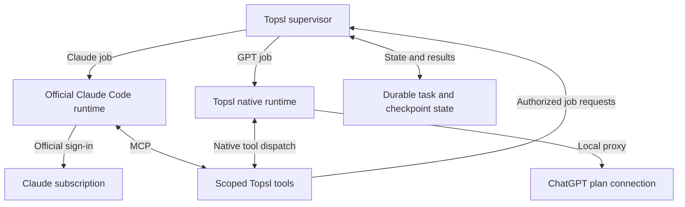

> **Status — 6 November 2026.** Copied verbatim from the owner's implementation brief, reviewed against `b87f501`. It is a proposed migration plan, not a description of current behavior. What was established and changed against it, phase by phase, is in the [execution record](Subscription_Runtime_Execution.md); current behavior stays in [Implementation status](Implementation_Status.md#subscription-runtime-architecture--6-november-2026) and the documents it links.

# Topsl Subscription Runtime Architecture — Instructions and Implementation Plan

**Purpose:** Adapt the existing Topsl application into a supervisor over the official Claude Code runtime and Topsl's native GPT runtime, using each provider's supported subscription connection.

**Repository:** [Piore-Galore/Topsl](https://github.com/Piore-Galore/Topsl)  
**Reviewed baseline:** [`b87f501ec54e0ba08d7bd59d8a416e8030a1e3ff`](https://github.com/Piore-Galore/Topsl/commit/b87f501ec54e0ba08d7bd59d8a416e8030a1e3ff)  
**Review date:** 5 November 2026 UTC  
**Document status:** Proposed implementation instructions. Repository and documentation inspection completed; implementation, application tests, live sign-in, and provider inference were not performed for this document.

The product's canonical name is **Topsl**. This document uses that name throughout.

## How to use this document

Give this entire document to the implementation agent working in the Topsl repository. Section 1 is the execution brief. The remaining sections define the architecture, existing code to reuse, migration phases, acceptance requirements, and source evidence.

Use phases and acceptance gates; there is no calendar timeline. If the checkout has advanced beyond the reviewed commit, reconcile the plan with current code before editing. Preserve newer working implementations.

## 1. Instructions for the implementation agent

Implement this architecture in the existing repository:

1. **Keep Topsl in control of workflows.** Preserve its projects, sessions, role groups, selection, task state, Goal/Endless loops, checkpoints, candidate integration, approvals, usage views, and workspace ownership.
2. **Use the official, unmodified Claude Code process for Claude subscription jobs.** Claude Code owns its Claude conversation, model requests, inner tool loop, and authentication. Topsl supplies task instructions, supported configuration, and explicitly scoped tools, then observes the result.
3. **Keep Topsl's native harness for GPT.** Reuse the existing ChatGPT plan connection and local proxy. Audit its current protocol against the official Sign in with ChatGPT documentation before extending it.
4. **Retain Codex and other existing supported routes.** Codex remains an available execution engine. Native API-key, local-model, and external-service routes retain their existing purpose. The required subscription architecture must work without making Codex mandatory.
5. **Extend the existing orchestration interface.** Reuse `MemberTurn`, `AttemptObservation`, `OrchestrationDriver`, `ExecutionBinding`, and their persistence. Add only the fields and capabilities the implementation actually needs.
6. **Preserve provider-independent roles.** Any eligible engine/model can fill any compatible role. Multiple members can share a role, including more than two coordinators or reviewers. Preserve automatic assignment and explicit user overrides.
7. **Keep the retired direct Claude-plan connection retired.** Preserve tombstones, blocked dispatch, history, and migration tests. Do not restore direct Claude subscription OAuth in the proxy or move the same credential-replay behavior into another repository or service.
8. **Use a separate delegation authority.** If adding model-initiated cross-engine jobs, expose them through an attempt-bound tool interface. Preserve the general context MCP endpoint's read-only authority.
9. **Preserve execution identity.** An active attempt retains its engine, model, account/profile, funding route, policy revision, and workspace identity. Changing one creates a new attempt from an explicit checkpoint.
10. **Preserve user-selected policy.** Carry existing grants and permission settings through both engines. Do not add confirmations merely because a task crosses providers, and do not broaden permissions to make a failing integration test pass.
11. **Use evidence-based capability gates.** Keep requested, observed, enforced, unsupported, and unknown capabilities distinct. An official CLI feature is not automatically supported by Topsl's adapter.
12. **Update canonical documentation with each behavior change.** Follow `AGENTS.md`, preserve dated evidence, and clearly separate implemented code from live-qualified behavior.

Begin by reading the repository instructions and the current implementation. Identify the smallest changes needed for each phase. Complete the meaningful automated checks for those changes. Where live account access or a platform is unavailable, finish the independently implementable work and record the exact remaining gate.

At completion, report:

- The architecture and behavior actually changed.
- Files and persistence schemas changed.
- Checks actually executed and their results.
- Live provider and platform evidence, separately from fixtures.
- Deferred optional capabilities and concrete blockers.
- Any remaining migration or compatibility limitations.

## 2. Target architecture and ownership

### 2.1 Execution topology



The diagram shows the two required subscription paths. Existing Codex, API-key, local-model, and external-service paths remain additional choices in the same supervisor.

### 2.2 Responsibility table

| Responsibility | Owner |
| --- | --- |
| Project and session identity | Topsl |
| Role selection, rosters, rounds, and aggregation | Topsl |
| Goal/Endless iteration and completion decisions | Topsl |
| Claude conversation, internal inference, and runtime tool loop | Claude Code |
| Claude subscription login and credential maintenance | Claude Code |
| Native GPT inference and tool loop | Topsl native harness |
| ChatGPT OAuth registration and renewable credentials | Existing isolated Topsl proxy/credential subsystem |
| Cross-engine task dispatch and recovery | Existing Topsl orchestration layer |
| Workspace copies, candidates, leases, and integration | Existing Topsl workspace/orchestration components |
| Shared task summaries, artifacts, decisions, and evidence | Topsl |
| Provider-specific conversation state | The execution engine that created it |
| Permission enforcement | Topsl at its authority boundaries, plus the selected runtime's actual controls |
| Usage observations and unavailable-capacity state | Topsl, retaining source and uncertainty |

### 2.3 Required operating modes

**Topsl-supervised mode is the default.** Structured coordinator outputs drive the existing orchestration engine, which schedules eligible workers and reviewers. The coordinator can be Claude, GPT, Codex, or a supported group of members.

**Tool-driven delegation is an optional extension.** A coordinator can request child jobs through scoped Topsl tools. Topsl validates and schedules those jobs. A Claude coordinator can therefore delegate to GPT, and a native GPT coordinator can delegate to Claude.

**Claude Code's native subagents are a separate capability.** They are not required for cross-provider delegation. Keep the current unsupported native-subagent boundary until independently implemented and qualified.

The architectural unit is an agent job/session. Do not place a Claude Code subprocess into `ProxyModelClient.stream()` as if it were an ordinary raw model request.

## 3. Baseline: what already exists

This migration consolidates and extends existing structures. It does not require replacing the application with a new agent framework.

### 3.1 Verified existing structures

- `ExecutionEngine` already contains `native`, `codex`, and `claude-code`.
- `ExecutionBinding` freezes route/installation, model settings, account/funding identity, and policy evidence.
- `OrchestrationDriver` already covers route enumeration, capacity, launch, lookup, observation, interruption, candidate integration, and application.
- Service wiring already combines the runtime manager and native member host into `RuntimeOrchestrationDriver`, then uses the existing orchestrator and session/loop supervisors.
- Role groups already support more than two members; the current default limit is eight and the policy ceiling is 64. Preserve the configurable policy rather than inventing a two-member restriction.
- Native routes already participate in teams, sessions, and loops.
- The desktop proxy process already isolates model credentials from the renderer and ordinary service/tool payloads.

Sources: [execution types][R-types], [role groups][R-roles], [orchestration contract][R-engine], [runtime driver][R-driver], [service wiring][R-service].

### 3.2 Current limitations that must remain explicit

| Area | Current baseline | Implementation implication |
| --- | --- | --- |
| Claude sessions | Fresh session per connection; resume rejected; one turn per connection | Deliver the initial migration with explicit task handoffs. Add persistent sessions only as a separately qualified extension. |
| Claude Topsl tools | Declared toolsets accepted only in review mode | Do not assume tools are available in edit/implementation sessions. Add a purpose-specific tool profile if needed. |
| Claude native subagents | Nested events with `parent_tool_use_id` are rejected | Topsl-managed child jobs can work without removing this guard. |
| Claude settings | Current tool profile disables hooks and uses controlled settings/MCP configuration | Preserve these semantics until a justified capability change is qualified. |
| Claude isolation | Current adapter does not establish OS filesystem isolation | A successful CLI run cannot upgrade that claim. |
| Native coordinated members | Read/edit according to purpose; no processes, network, checks, delegation, or MCP tools | Standalone native task capabilities do not automatically transfer to members. |
| Native member request budget | Current default is 50 model requests | Preserve or deliberately expose this policy; Endless mode does not require unbounded individual attempts. |
| Native child delegation | Existing `delegate()` copies the parent's binding | Cross-engine dispatch requires the supervisor, not a model-name substitution. |
| ChatGPT native route evidence | Current README labels this integration synthetic-only | Real sign-in and completed inference are separate release evidence. |
| General context MCP | Deliberately excludes administrative/execution authority | Add scoped job tools separately. |
| Retired Claude-plan route | Historical bindings fail closed | Preserve that behavior through migration and recovery. |

Sources: [Claude adapter][R-claude], [native harness][R-harness], [README][R-readme], [context authority tests][R-context-test], [retirement handling][R-retirement].

### 3.3 Repository change map

All paths below exist at the reviewed baseline. New modules proposed later in this document must be named consistently with the current checkout.

| Area | Existing paths to inspect and extend |
| --- | --- |
| Shared execution contracts | `packages/orchestration/engine.ts`; `packages/harness/types.ts`; `packages/providers/contract.ts` |
| Dispatch and route selection | `packages/orchestration/runtime-driver.ts`; `routing.ts`; `selection.ts`; `membership.ts` |
| Sessions and loops | `packages/orchestration/session-engine.ts`; `loop-engine.ts`; `repository.ts` |
| Roles and scheduling | `packages/domain/role-groups.ts`; `packages/orchestration/roles.ts`; `schedule.ts` |
| Claude process integration | `packages/providers/claude.ts`; `claude-tools.ts`; `tool-calls.ts` |
| Runtime lifecycle | `packages/runtime/manager.ts`; `coordinator.ts`; `process-lifecycle.ts`; `concurrency.ts` |
| Qualification | `packages/providers/claude-qualification.ts`; `qualification.ts`; `acceptance.ts`; `runtime-binding.ts`; `readiness.ts` |
| Native execution | `packages/harness/harness.ts`; `kernel.ts`; `model-client.ts`; `journal.ts`; `resources.ts` |
| GPT and other model connections | `packages/proxy/oauth/chatgpt.ts`; `adapters.ts`; `service.ts`; `types.ts`; `credentials.ts` |
| Retirement and migration | `packages/proxy/retirement.ts`; `packages/persistence/migrations/native.ts` |
| Workspace ownership | `packages/workspace/ownership.ts` |
| Service composition | `apps/service/service.ts`; `native.ts`; `worker.ts` |
| Desktop/credential boundary | `apps/desktop/main.ts`; `proxy-host.ts`; `preload.ts` |
| Coordinator UI | `apps/desktop/renderer/coordinator/role-editor.tsx`; `composer.tsx` |
| Connection/task UI | `apps/desktop/renderer/screens/connections.tsx`; `providers.tsx`; `native-tasks.tsx`; `apps/desktop/renderer/components/transcript.tsx` |

Do not create a second engine enumeration or scheduler simply to mirror the diagram. Retain persisted provider strings and backward-compatible `memberEngine()` interpretation. In particular, `provider: native` identifies an execution category; it does not mean every native route is OpenAI.

## 4. Provider integration requirements

### 4.1 Claude runtime and product boundary

The implementation basis is Anthropic's documented unmodified-runtime hosting pattern: preserve the published binary and built-in authentication methods; users authenticate for their own usage; the product operator follows the stated terms and attribution conditions. Topsl retains runtime/profile references and sanitized status, rather than collecting Claude subscription tokens. The SDK's separate login restriction must not be treated as blanket authorization for a custom login wrapper. [A1][A2]

Keep native Claude API connections distinct from Claude subscription execution. A supported API-key connection can still use Topsl's native loop; that does not revive the retired subscription adapter.

Do not build the architecture around GPT replacing Claude underneath Claude Code. Anthropic explicitly excludes support for non-Claude model routing through gateways. [A3]

### 4.2 Claude launch and session contract

Use the official CLI execution interface, with version-qualified argument profiles. The current adapter's print/streaming route is the starting point. Official commands support programmatic execution and explicit session identifiers; Topsl must separately implement and qualify each behavior it exposes. [A4][A5]

Requirements for the adapter:

- Resolve a trusted executable and its current runtime revision.
- Build arguments without shell interpolation of task text.
- Preserve the selected profile and effective launch configuration.
- Parse structured events incrementally, preserving diagnostics separately.
- Map terminal results, interrupted runs, permission denials, and transport failures accurately.
- Require the expected tools/MCP binding to be usable before accepting a tool-dependent result.
- Bind backend session identifiers to the owning project, attempt, profile, and workspace.
- Keep built-in native-subagent events unsupported unless explicitly qualified.

Current headless documentation adds specific compatibility checks: bare mode skips subscription OAuth; a future release is expected to change the `-p` default. Startup events may precede `system/init`; that event exposes capabilities and MCP load errors. A clean exit can coexist with rejected MCP configuration. SIGTERM leaves a turn unfinished, and background MCP work is not reliably collected at process exit. [A4]

Therefore, implement profile-specific readiness and cancellation using documented behavior of the installed release. Do not invent future flags or infer success from exit code alone.

### 4.3 Authentication and actual billing source

Use official authentication status under the same profile and effective launch environment. `claude auth status` exposes an authentication method and, on supported releases, the configuration directory. Official multi-account support uses `CLAUDE_CONFIG_DIR`; Topsl may keep a directory reference while Claude Code manages its contents. [A5][A6]

API credentials can outrank a saved subscription login; in noninteractive mode an inherited `ANTHROPIC_API_KEY` is used when present. Cloud selection, gateway credentials, and helpers also matter. Detect disagreement between the requested funding route and observed authentication. Respect managed policy and preserve other supported login methods. [A6]

Implement a clear distinction between:

- The route the user selected.
- The route the adapter can currently observe.
- The route verified by current qualification evidence.
- Unknown or conflicting evidence.

Do not silently change funding to make a task run. Resolve conflicts through the existing connection/policy workflow.

Subscription-authenticated `claude -p` currently draws from subscription limits; API-key execution follows a separate accounting path. The plan does not promise unlimited multi-agent usage. [A7]

### 4.4 GPT connection

Preserve and audit `packages/proxy/oauth/chatgpt.ts`. Its existing registration and credential lifecycle should be extended only where current documentation or tests demonstrate a gap.

Validate the OAuth attempt, PKCE, state, nonce, and ID token. Retain the issued client ID with the validated identity and a stable host ID. Plan inference requires the granted `chatgpt.tokens.use.direct` permission; identity-only sign-in remains a valid signed-in state without inference access. [O1]

Keep credential renewal serialized for each renewable session and save rotated tokens atomically. Account registrations remain distinct even when their email addresses match. Maintain the existing isolated credential process. [O2]

The required direct inference route is the public Responses endpoint, with the selected account's available model catalog and a completed terminal event. A stream containing text followed by failure is partial output. [O3]

Current plan-route serialization is narrower than generic Responses:

- Use HTTP `store: false`, `stream: true`, and explicit input history.
- Use instructions/developer messages rather than explicit system-role items.
- Omit HTTP `previous_response_id` and unsupported request fields.
- Encode function/custom tools using the documented namespace or `additional_tools` form.
- Do not emit unsupported hosted MCP/connectors, Responses `tool_search`, or other unsupported hosted tools.

Topsl can execute its own tools locally through supported model calls. Validate the full current compatibility list in the route-specific serializer. [O4]

Handle limit, admission, capability, temporary availability, and confirmed revocation errors distinctly. Preserve credentials on temporary infrastructure failures. A plan-limit error is not evidence of a known reset time or exhaustion of every use of the account. Billing changes require the configured fallback policy. [O5]

The public flow targets eligible open-source/local deployments. Paid or remotely hosted distribution has a separate access path; a valid implementation does not guarantee a particular account, model, workspace, or deployment is admitted. [O6]

## 5. Shared execution and state contracts

### 5.1 Extend existing contracts

Use `MemberTurn` as the normalized launch request and `AttemptObservation` as the normalized observation. Keep `OrchestrationDriver` responsible for dispatch and collection.

The current contracts already carry substantial context. Add fields only after identifying a specific missing requirement. Candidate additions include:

| Information | Purpose |
| --- | --- |
| Backend session reference | Resume or diagnostic correlation, opaque outside the adapter |
| Tool-manifest/profile digest | Bind qualification to the actual tools and launch behavior |
| Requested and observed funding evidence | Explain conflicting or unknown billing observations |
| Parent/root job relationship | Cross-engine child ownership and cumulative accounting |
| Delegation grant reference | Verify the tool's authority independently of its prompt |
| Terminal outcome reason | Distinguish blocked, interrupted, failed, and completed work |
| Observation sequence/deduplication identity | Prevent reconnect/replay from repeating effects or usage |

These are conceptual fields, not a demand to rename or duplicate existing equivalents.

Do not unify away meaningful differences. An adapter may report a capability as observable without being able to enforce it. Unsupported resume is different from a failed resume. A native token estimate is different from a provider-reported usage observation.

### 5.2 Four lifetimes

Keep these distinct:

1. **Model turn:** one reasoning episode, which may issue tools.
2. **Execution attempt:** execution under one frozen engine, model, account, funding, policy, and workspace binding.
3. **Agent job:** stable assigned work that may have several attempts, permitted retries, or explicit handoffs.
4. **Workflow:** a session, team goal, or Goal/Endless loop.

Keep job identity stable across permitted retries and retain its attempt history. An account or engine change creates a new attempt without rewriting an earlier binding.

A model turn finishing does not by itself complete the workflow or cancel durable child jobs. A user stop does fence new work and initiates cancellation of the relevant descendants.

### 5.3 Recovery and completion

Reuse existing launch intents, `launchId`, `findLaunch()`, generation fences, journals, and candidate capture.

A completed inference result is necessary but may be insufficient for a completed editing job: Topsl must also settle owned effects, capture the candidate, and run the required acceptance checks.

Do not immediately retry an uncertain launch. First reconcile whether the prior attempt exists or still owns effects. A late result from an earlier control generation remains historical evidence and cannot replace the current accepted state.

### 5.4 Portable context

Build handoffs from Topsl-owned information:

- Task/goal and acceptance criteria.
- Applicable project instructions.
- Frozen assignment and permitted outputs.
- Accepted baseline/candidate and relevant source references.
- Completed work, decisions, unresolved questions, and test evidence.
- Relevant artifacts and concise prior results.

Provider-specific transcripts and compaction state remain associated with their engine. A provider change creates a new attempt with an explicit context package.

Preserve currently supported project management, history imports, retained conversations, and skills/plugins behavior. Keep retired native desktop, synchronization, and history-source workflows retired; this architecture does not restore them. Show capabilities per engine without implying every vendor-specific feature is available in every execution mode. [R-native-retirement]

## 6. Phased implementation plan

**Core delivery order:** Phase 0 → Phase 1 → Phases 2 and 3 → Phase 4 → Phase 5 → Phase 8 → Phase 9. The Claude and GPT backend work can proceed independently once the shared contract is stable.

Phases 6 and 7 extend the core when their capabilities are needed. A tool-driven coordinator requires Phase 6; implementation tasks needing additional member tools require the applicable parts of Phase 7. Repeat the affected UI, migration, and qualification gates when enabling either extension.

### Phase 0 — Reconcile the current checkout and establish the baseline

**Work**

1. Read `AGENTS.md`, its `CLAUDE.md` pointer, and relevant canonical design/status documents.
2. Record the actual commit, working-tree changes, runtime versions, and supported platforms.
3. Trace one existing native member and one existing Claude member through service wiring, dispatch, persistence, and collection.
4. Map the current capability and qualification records to the baseline in Section 3.
5. Identify existing tests covering each invariant before adding new ones.

**Deliverables**

A focused implementation checklist and a baseline note under `docs/`, linked to the canonical status document.

**Acceptance**

The agent identifies what is already implemented, what needs modification, and which claims are only synthetic. No new architecture module duplicates an existing responsibility.

### Phase 1 — Consolidate the execution boundary without changing workflow semantics

**Work**

1. Refine the existing driver/adapters around a clear task launch/observe/interrupt/collect lifecycle.
2. Preserve `ExecutionEngine`, legacy provider tags, assignment inference, and frozen `ExecutionBinding`.
3. Normalize necessary result/error/session metadata, retaining backend-specific details behind the adapter.
4. Preserve distinct workspace copies, launch-intent recovery, candidate capture, and readiness admission.
5. Route existing structured coordinator, worker, and reviewer turns through this boundary.
6. Keep fresh-session Claude execution and current native member grants for this phase.

**Primary files**

`packages/orchestration/engine.ts`, `runtime-driver.ts`; `packages/harness/types.ts`; `packages/providers/contract.ts`; service composition.

**Acceptance**

Existing native, Claude, and Codex fixtures behave equivalently before and after consolidation. A change of account/model/engine/funding cannot mutate an in-flight attempt.

### Phase 2 — Make the Claude runtime connection and funding observation reliable

**Work**

1. Reuse installation discovery, trusted executable identity, profile selection, and the official authentication UI/command.
2. Observe authentication using the selected profile/environment; retain only sanitized metadata.
3. Add conflict reporting for a requested subscription route whose effective authentication differs or is unknown.
4. Verify that required Topsl MCP tools are available for the exact launch profile.
5. Harden stream parsing for startup events, capability negotiation, partial output, denial, interruption, and errors.
6. Requalify changed argument/tool profiles rather than lifting the current gates.
7. Preserve built-in authentication methods and managed policy.

**Acceptance**

A synthetic conflict cannot be displayed as a verified subscription run. Missing required tools cannot produce a successful tool-dependent task. Runtime or tool-profile changes invalidate the affected evidence.

**Live gate**

A bounded official-Claude session with user-owned subscription authentication proves only the exact profile, platform, version, and capabilities exercised.

### Phase 3 — Verify and harden the native ChatGPT plan path

**Work**

1. Audit the existing OAuth flow and account/refresh lifecycle against Section 4.4.
2. Preserve separate account registrations and credential-process isolation.
3. Add route-specific request validation for current plan-inference restrictions.
4. Keep model/effort/context choices derived from available route/account capabilities.
5. Treat incomplete, failed, and interrupted streams as distinct from completed output.
6. Map account-level waits through the existing quota owner.
7. Preserve existing API-key, external-service, local-model, and retired-route behavior.

**Primary files**

`packages/proxy/oauth/chatgpt.ts`, `adapters.ts`, `service.ts`, `credentials.ts`; `packages/harness/model-client.ts`; associated tests.

**Acceptance**

Fixtures cover consent denial, account switching, concurrent refresh, unsupported request shapes, terminal failures, and no implicit funding change.

**Live gate**

An authorized account completes a native-harness task through the public plan route, including at least one supported Topsl tool call. A vendor Codex session does not substitute for this evidence.

### Phase 4 — Complete mixed-engine structured workflows

**Work**

1. Preserve existing provider-independent route selection and per-purpose readiness.
2. Exercise Claude and native GPT in both coordinator/worker directions.
3. Support groups with more than two members while preserving stable IDs, explicit rosters, contribution requirements, endorsement rules, and frozen electorates.
4. Keep user-pinned model/engine/account/funding choices and explicit fallbacks.
5. Pass portable task packages and candidate/checkpoint references across engines.
6. Show actionable blockers when a required member is unavailable.

**Acceptance**

A GPT coordinator can assign Claude work and receive its result; a Claude coordinator can assign GPT work. This phase uses the existing structured orchestration protocol and does not require native nested subagents or arbitrary job tools.

A GPT-only workflow remains runnable when Claude is unavailable. A workflow requiring Claude retains that requirement rather than silently dropping the member.

### Phase 5 — Integrate Goal/Endless behavior, quotas, and recovery

**Work**

1. Keep loop control in `loop-engine.ts`; adapt execution beneath it.
2. Preserve accepted checkpoints, regression handling, goal evidence, and automatic organization.
3. Apply automatic role/model adjustments to future assignments at controlled boundaries. Explicit user overrides remain authoritative.
4. Respect existing account-level allowance waits across routes sharing a quota owner.
5. Fence new work before stop/cancel, reconcile active descendants, and preserve uncertain ownership.
6. Maintain restart recovery without duplicate launches or repeated completed effects.
7. Use scheduler backoff when work cannot progress; avoid busy retries.

**Acceptance**

Goal mode reaches completion only through the existing acceptance protocol. Endless mode continues until stopped or blocked under its policy, while individual attempts remain bounded. Stop intent survives restart, and late results cannot advance a stopped generation.

### Phase 6 — Add optional, scoped cross-engine delegation

This is an extension after structured workflows are stable. It must be available symmetrically to qualified Claude and native GPT coordinators.

**Work**

1. Create a small supervisor-owned job dispatch service inside the existing orchestration architecture.
2. Expose it through the attempt-bound Claude MCP bridge and native tool dispatcher.
3. Define narrowly scoped operations such as `start_agent_job`, `get_agent_job`, and `cancel_agent_job`. Names are illustrative.
4. Resolve a child through existing assignment, readiness, funding, workspace, and scheduler rules.
5. Add a deliberate delegation grant for coordinated native members. Do not import every standalone native capability.
6. Preserve the general context MCP endpoint's no-execution boundary.
7. Implement the durable semantics in Section 7 before enabling the tool in production.

**Acceptance**

Claude can request a native GPT child and GPT can request a Claude child. Both use the same scheduling/accounting/recovery service. Duplicate calls create one job, cross-project requests fail, and a child cannot broaden the root grant.

**Scheduling gate**

A coordinator waiting for a child must not deadlock when available capacity is one. If the current vendor reservation cannot safely yield, use a supervisor continuation after the coordinator turn finishes, or report the capacity requirement. Never falsely mark a running process as terminated.

### Phase 7 — Add richer member capabilities only where required

Prioritize the tools needed for actual implementation and verification jobs, such as controlled command/check execution and approved MCP tools.

**Work**

1. Extend native member grants deliberately for each supported purpose.
2. Add corresponding Claude launch/tool profiles where an equivalent workflow is required.
3. Keep semantic purpose separate from filesystem mode: being a coordinator does not inherently grant write access.
4. Verify real permission outcomes, cancellation, and workspace effects for each profile.
5. Keep hooks, persistent Claude sessions, and native Claude subagents as separate opt-in capability projects.

**Acceptance**

The UI and scheduler expose only capabilities supported by the selected binding. Existing read-only profiles remain read-only under their actual enforcement model. Runtime denials produce accurate blocked results.

Persistent Claude resume and native subagents are not prerequisites for the two-subscription architecture. Implement them only when the product benefit justifies their additional qualification.

### Phase 8 — Update the product UI and usage presentation

**Work**

1. Keep model/provider, execution engine, account/profile, and funding source distinguishable.
2. Present understandable choices such as “Claude through Claude Code” and “GPT through Topsl,” while preserving existing engine identifiers internally.
3. Display readiness reasons and the exact capability missing for a role.
4. Provide separate connection actions for official Claude runtime authentication and ChatGPT plan authorization.
5. Preserve multi-account selection and show which connection a job is using.
6. Surface partial results, queued/blocked jobs, cancellation progress, and parent/child relationships.
7. Separate token observations, cost estimates, and known subscription allowance state.

**Acceptance**

A user can create mixed roles, select more than two members, inspect the engine/funding path, and stop work from the existing Topsl UI. Unknown quota or billing evidence is visibly unknown.

Avoid showing an estimated token cost as an actual charge against a flat subscription. If cumulative provider usage is reported on resumed sessions, account for the increment rather than counting the total again.

### Phase 9 — Migrate state, document behavior, and qualify the release

**Work**

1. Use backed-up, versioned migrations and the existing old-writer/schema fences.
2. Preserve existing projects, histories, rosters, pins, candidates, accepted checkpoints, and usage evidence.
3. Add new fields conservatively; missing historical evidence remains unknown.
4. Keep retired Claude-plan configurations and frozen old attempts non-runnable.
5. Update canonical documents and release notes without rewriting historical evidence.
6. Run the meaningful automated, desktop, live-provider, and packaged-platform checks appropriate to the claims being released.
7. Record remaining unsupported capabilities plainly.

**Acceptance**

Existing data retains its meaning, the core two-subscription workflow has bounded live evidence, and platform claims match actual qualification. If live access is unavailable, code may be marked implemented with that gate pending; it must not be marked live-verified.

### Optional follow-on — Codex app-server as another GPT engine

Retain the current Codex integration. If a separate app-server path is desirable, add it behind the same execution boundary, not as a replacement for the native route.

OpenAI documents app-server configured with authorized plan credentials and an application-managed refresh/restart flow. Use its actual RPC/thread interface and current compatibility restrictions. [O7]

Qualify this path independently. Its success does not establish native-harness compatibility, and its failure must not disable the native GPT route.

## 7. Delegated job protocol and authority

### 7.1 Scope comes from the authenticated binding

The attempt-bound tool endpoint determines the caller's project, root workflow, parent attempt, control generation, and grants. Model-provided identifiers are references to validate, not authority.

A job request may specify a task, requested role/model or eligible selection policy, relevant context references, and acceptance criteria. It must not supply provider credentials, an arbitrary executable, unrestricted filesystem access, or a broader permission grant.

Use existing policy to decide authorized operations. Routine delegation within an already-authorized workflow does not need a new blanket approval step.

A coordinator's direct filesystem permissions and its authority to request child work are distinct. A read-only coordinator may request an implementation child when the root workflow's grant and its scoped delegation authority permit that operation. Derive child grants from those authorities, the child's role, and its permitted outputs. Do not grant the coordinator direct write access merely to enable delegation.

### 7.2 Durable start semantics

For each proposed child job:

1. Resolve a stable idempotency identity from the parent attempt/tool-call identity.
2. Compute and retain a digest of the normalized request.
3. Atomically record the child intent, generation, grants, and reserved assignment.
4. Dispatch through the existing driver using a persisted launch identity.
5. Record the created attempt/session association.
6. Return a durable job ID and current state.

An identical retry returns the existing job. The same identity with different arguments is a conflict.

Existing command receipts can coalesce concurrent calls, but a receipt written after completion does not replace the pre-dispatch intent needed for crash recovery.

### 7.3 Status, results, and cancellation

Use asynchronous job IDs and durable status. A long MCP request must not be the only owner of a child job.

A status result should distinguish queued, running, blocked, stopping, uncertain, completed, and failed concepts, mapped to the repository's actual state schema. Include a concise result and references to larger artifacts; avoid repeatedly copying full transcripts.

Normal completion of the coordinator's model turn leaves explicitly owned child jobs under Topsl supervision. Cancellation of the root fences new children and propagates to active descendants. Retain stopping/uncertain state until owned effects have settled.

A retry must not execute a previously completed tool effect again. Store stale observations for diagnostics without promoting them into the current control generation.

### 7.4 Scheduling and permissions

Reuse existing inference, process, and workspace resources. A waiting parent may release an inference reservation where the backend actually supports that, while retaining necessary process and writer ownership.

All children count against the appropriate root and account budgets. Prevent recursive task creation from multiplying effective grants or bypassing configured concurrency.

MCP tool retry hints must describe real idempotency. Permission behavior remains runtime-specific: for example, tools requiring human interaction cannot be assumed to run under a non-prompting Claude profile. [A8]

## 8. Migration, compatibility, and rollback

### 8.1 Data migration rules

- Preserve legacy `provider` and engine interpretation; add explicit display metadata rather than silently changing meaning.
- Keep native upstream provider identity separate from the native execution engine.
- Preserve frozen route revisions and installation identities.
- Never infer new subscription verification from old API or synthetic records.
- Associate new delegated jobs with existing root/session/attempt identities.
- Preserve retirement tombstones and the historical readability of retired connections.
- Make new persisted relationships recoverable when the application stops between intent and dispatch.

### 8.2 Feature rollout

Use capability/feature gates for new delegation and richer member tools. Keep existing structured workflows usable while those extensions are being qualified.

An adapter upgrade should invalidate only the affected qualification where scope can be established. It must not erase unrelated evidence or disable an independent provider unnecessarily.

### 8.3 Recovery and rollback behavior

If a new path fails, stop admitting new work to that path and preserve active job ownership for reconciliation. Fall back only through the user's configured routing and funding policy.

Database rollback must use the repository's supported backup/schema recovery procedure. Do not run an old writer against a newer schema or restore a backup over active work. Preserve a readable export of new history where a downgrade cannot retain its structures.

Do not delete native harness code, old job history, or current vendor adapters as a shortcut to simplify the migration.

## 9. Acceptance matrix

These are requirements for the implementation, not results established by this planning document.

Account identity alone does not establish a shared allowance across subscription, API, cloud, and external-service funding paths. Group waits by the verified allowance owner and scope, preserving independent billing routes.

| Scenario | Required result | Evidence |
| --- | --- | --- |
| GPT coordinator → Claude worker → GPT reviewer | Correct engines and frozen assignments; accepted result returns through Topsl | Integration fixture, then bounded live pilot |
| Claude coordinator → GPT workers | Topsl schedules workers; Claude receives portable results | Integration fixture, then bounded live pilot |
| Three coordinators and five reviewers | All required members and aggregation semantics preserved | Role/orchestration tests |
| GPT-only workflow while Claude is unavailable | GPT workflow remains usable | Integration/UI test |
| Workflow explicitly requiring unavailable Claude | Visible blocker; required member is retained | Selection/UI test |
| Conflicting Claude API credential | No false subscription label or silent funding change | Auth/profile fixture and qualified runtime check |
| Claude binary/tool-profile changes | Affected qualification invalidated or renewed | Runtime binding tests |
| Missing required Topsl MCP binding | Task does not pass solely because process exits cleanly | Stream/qualification fixture |
| Permission-denied tool | Accurate denial/blocked outcome; no fabricated success | Adapter and tool tests |
| ChatGPT identity sign-in without plan permission | Signed-in account retained; plan inference disabled | OAuth test |
| Concurrent refresh on one ChatGPT registration | One serialized rotation; no mixed credentials | Credential lifecycle test |
| Two registrations with the same email | Independent identity/client/token association | Account test |
| Unsupported plan-route parameter/tool | Correct route-specific validation or supported translation | Serializer contract test |
| Stream text followed by failure | Partial evidence retained; attempt not successful | Stream test |
| Routes sharing a verified quota/allowance owner | Shared quota wait, without invented reset time | Quota test |
| Duplicate child start | One durable child and stable result | Recovery/idempotency test |
| Reused child key with changed arguments | Conflict; no second effect | Authority test |
| General context MCP attempts to start a job | Execution remains unavailable | Existing MCP authority regression |
| Attempt-bound tool targets another project | Rejected without widening scope | Delegation authority test |
| Parent finishes a model turn while child runs | Durable child remains observable and controlled | Lifecycle test |
| Root stop while mixed children run | New launches fenced; descendants reconciled | Lifecycle/restart test |
| Capacity one with parent waiting | No deadlock or overbooking | Scheduler test |
| Crash at each launch boundary | Existing intent/attempt adopted once | Durable execution test |
| Late result from old generation | Historical only; no current-state promotion | Generation test |
| Parallel Claude/GPT writers | Separate workspace copies; explicit candidate integration | Workspace test |
| Goal completion and Endless continuation | Existing acceptance and stop semantics preserved | Loop tests |
| Upgrade from old state | Histories/pins/checkpoints survive; new evidence unknown | Migration test |
| Retired Claude-plan binding recovered | Remains blocked | Retirement tests |
| Packaged runtime on each claimed OS | Correct executable discovery, sign-in handoff, process cleanup, and UI | Platform-specific packaged check |

### 9.1 Existing suites to extend

Inspect and extend the relevant current tests rather than creating an entirely separate suite:

- `tests/claude-provider.test.ts`
- `tests/runtime-qualification.test.ts`
- `tests/provider-readiness.test.ts`
- `tests/native-members.test.ts`
- `tests/native-sessions.test.ts`
- `tests/native-loops.test.ts`
- `tests/native-mcp-recovery.test.ts`
- `tests/proxy-chatgpt-auth.test.ts`
- `tests/proxy-retirement.test.ts`
- `tests/native-retirement.test.ts`
- `tests/orchestration.test.ts`
- `tests/orchestration-service.test.ts`
- `tests/recursive-loops.test.ts`
- `tests/session-loops.test.ts`
- `tests/lifecycle.test.ts`
- `tests/durable-executions.test.ts`
- `tests/parallel-workspaces.test.ts`
- `tests/campaign-storage-authority-mcp.test.ts`

Add focused failure/recovery cases where these suites lack coverage. Do not add assertions that only mirror implementation details.

### 9.2 Verified repository commands

The repository requires Node >=22.12.0. Use a version supported by the current checkout and recheck `package.json` when implementing. [R-package]

```bash
npm ci
npm run typecheck
npm test
npm run test:release
npm run build
git diff --check
```

The aggregate command is:

```bash
npm run check
```

It combines type checking, integration tests, release tests, and build. It does not include desktop tests. Use the aggregate or its components as appropriate rather than running both redundantly.

Examples of focused checks supported by the current test script:

```bash
npm test -- tests/claude-provider.test.ts tests/runtime-qualification.test.ts tests/provider-readiness.test.ts
npm test -- tests/native-members.test.ts tests/native-sessions.test.ts tests/native-loops.test.ts
npm test -- tests/proxy-chatgpt-auth.test.ts tests/proxy-retirement.test.ts tests/native-retirement.test.ts
```

Relevant desktop journeys:

```bash
npm run test:desktop -- scripts/desktop-coordinator-test.mjs
npm run test:desktop -- scripts/desktop-session-test.mjs
npm run test:desktop -- scripts/desktop-loop-test.mjs
npm run test:desktop -- scripts/desktop-native-test.mjs
```

Use the existing CI display setup on headless Linux. Expand testing to resolve a concrete risk or required release gate. A fixture, UI journey, provider acceptance run, and packaged-platform test establish different things.

### 9.3 Live qualification record

For each live claim, record:

- Repository commit and build.
- OS/architecture and application packaging mode.
- Exact runtime identity and argument/tool profile.
- Selected engine, model, and sanitized connection/profile reference.
- Requested funding route and observed authentication/billing evidence.
- Task, tools, completion/cancellation behavior, and artifacts inspected.
- Result, limitations, and evidence location.

Do not store tokens, authorization URLs containing identity hints, or private account contents in evidence.

A live test using only vendor Claude/Codex sessions does not establish native ChatGPT plan inference. Include an explicit native route in the mixed-runtime pilot.

## 10. Documentation updates and completion criteria

### 10.1 Canonical documents

Update the affected documents in the same change cycle:

- `README.md`
- `docs/Topsl_Design.md`
- `docs/Implementation_Status.md`
- `docs/Native_Harness_Plan.md`
- `docs/Native_Harness_Execution.md`
- `docs/Coordinator_Teams.md`
- `docs/Native_Sessions_Plan.md`
- `docs/Recursive_Looping.md`
- `docs/Provider_Permissions_Plan.md`
- `docs/Claude_Workflows_Plan.md`
- `docs/Live_Provider_Sessions.md`
- Relevant version-specific release notes under `docs/releases/`

This plan may be copied to `docs/Subscription_Runtime_Architecture_Plan.md` as a distinct migration document. Link it from the canonical design/status documents; keep detailed current behavior in its existing home.

Follow the repository's documentation agreement: preserve historical results, record actual commands, distinguish proposed/implemented/verified behavior, and avoid treating one kind of evidence as another. [R-agents]

### 10.2 Core architecture is complete when

- Topsl remains the authoritative workflow supervisor.
- Claude subscription tasks run through the official unmodified runtime and its own authentication.
- Native GPT tasks use the authorized ChatGPT plan route.
- Existing Codex/API/local/external routes retain their behavior.
- Either qualified provider can fill coordinator, worker, and reviewer roles.
- More than two members per role remain supported.
- Goal/Endless modes, checkpoints, cancellation, and recovery work across engines.
- Credentials remain in their proper ownership boundaries.
- Funding and capability observations are truthful.
- Existing data and retired-route protections survive.
- Meaningful automated checks pass and live/platform claims have matching evidence.

### 10.3 Optional extensions have their own completion gates

Tool-driven cross-engine delegation, richer coordinated-member tools, persistent Claude sessions, native Claude subagents, and an additional Codex app-server route are independently qualified capabilities.

Their absence does not invalidate a completed structured two-subscription architecture. Their presence must not be claimed merely because the upstream runtime offers a similarly named feature.

## 11. Sources and evidence

Repository links are pinned to the reviewed commit. External documentation is current to the research date and must be rechecked before implementing authentication or relying on changed runtime defaults.

### Repository evidence

- [R-agents]: Repository working agreement and documentation requirements.
- [R-readme]: Current supported flows, limitations, and evidence status.
- [R-types]: Existing execution engines and frozen bindings.
- [R-roles]: Multi-member roles, compatibility, and assignment identity.
- [R-engine]: Existing orchestration contracts and deterministic workflow.
- [R-driver]: Mixed native/vendor dispatch, recovery, and candidate handling.
- [R-service]: Existing service/supervisor composition.
- [R-claude]: Official Claude subprocess adapter and current constraints.
- [R-bridge]: Attempt-bound Claude tool bridge.
- [R-harness]: Native member grants, execution, and delegation.
- [R-context-test]: General context MCP authority boundary.
- [R-retirement]: Direct Claude-plan retirement.
- [R-native-retirement]: Retired native desktop, synchronization, and history-source behavior.
- [R-package]: Current scripts and runtime requirements.

### Official provider documentation

- [A1]: Claude Code product hosting, authentication, and credential conditions.
- [A2]: Agent SDK ownership model and separate third-party login restriction.
- [A3]: Gateway support boundary.
- [A4]: Programmatic execution, streaming, startup, interruption, and bare mode.
- [A5]: CLI commands, authentication status, and configuration.
- [A6]: Authentication precedence and official account profiles.
- [A7]: Current subscription versus API-key metering.
- [A8]: MCP tools, permission behavior, and retry semantics.
- [O1]: ChatGPT registration, sign-in, identity, and plan scopes.
- [O2]: ChatGPT account isolation, token renewal, and credential lifecycle.
- [O3]: Model catalog and completed plan inference.
- [O4]: Plan-route compatibility restrictions.
- [O5]: Consent, availability, limit, and credential recovery.
- [O6]: Supported integration/deployment scope.
- [O7]: Optional Codex app-server integration.

[R-agents]: https://github.com/Piore-Galore/Topsl/blob/b87f501ec54e0ba08d7bd59d8a416e8030a1e3ff/AGENTS.md
[R-readme]: https://github.com/Piore-Galore/Topsl/blob/b87f501ec54e0ba08d7bd59d8a416e8030a1e3ff/README.md
[R-types]: https://github.com/Piore-Galore/Topsl/blob/b87f501ec54e0ba08d7bd59d8a416e8030a1e3ff/packages/harness/types.ts
[R-roles]: https://github.com/Piore-Galore/Topsl/blob/b87f501ec54e0ba08d7bd59d8a416e8030a1e3ff/packages/domain/role-groups.ts
[R-engine]: https://github.com/Piore-Galore/Topsl/blob/b87f501ec54e0ba08d7bd59d8a416e8030a1e3ff/packages/orchestration/engine.ts
[R-driver]: https://github.com/Piore-Galore/Topsl/blob/b87f501ec54e0ba08d7bd59d8a416e8030a1e3ff/packages/orchestration/runtime-driver.ts
[R-service]: https://github.com/Piore-Galore/Topsl/blob/b87f501ec54e0ba08d7bd59d8a416e8030a1e3ff/apps/service/service.ts
[R-claude]: https://github.com/Piore-Galore/Topsl/blob/b87f501ec54e0ba08d7bd59d8a416e8030a1e3ff/packages/providers/claude.ts
[R-bridge]: https://github.com/Piore-Galore/Topsl/blob/b87f501ec54e0ba08d7bd59d8a416e8030a1e3ff/packages/providers/claude-tools.ts
[R-harness]: https://github.com/Piore-Galore/Topsl/blob/b87f501ec54e0ba08d7bd59d8a416e8030a1e3ff/packages/harness/harness.ts
[R-context-test]: https://github.com/Piore-Galore/Topsl/blob/b87f501ec54e0ba08d7bd59d8a416e8030a1e3ff/tests/campaign-storage-authority-mcp.test.ts
[R-retirement]: https://github.com/Piore-Galore/Topsl/blob/b87f501ec54e0ba08d7bd59d8a416e8030a1e3ff/packages/proxy/retirement.ts
[R-native-retirement]: https://github.com/Piore-Galore/Topsl/blob/b87f501ec54e0ba08d7bd59d8a416e8030a1e3ff/tests/native-retirement.test.ts
[R-package]: https://github.com/Piore-Galore/Topsl/blob/b87f501ec54e0ba08d7bd59d8a416e8030a1e3ff/package.json
[A1]: https://code.claude.com/docs/en/legal-and-compliance
[A2]: https://code.claude.com/docs/en/agent-sdk/overview
[A3]: https://code.claude.com/docs/en/llm-gateway
[A4]: https://code.claude.com/docs/en/headless
[A5]: https://code.claude.com/docs/en/cli-reference
[A6]: https://code.claude.com/docs/en/authentication
[A7]: https://support.claude.com/en/articles/15036540-use-the-claude-agent-sdk-with-your-claude-plan
[A8]: https://code.claude.com/docs/en/mcp
[O1]: https://developers.openai.com/siwc/token-sharing-open-source/sign-in
[O2]: https://developers.openai.com/siwc/token-sharing-open-source/profiles-and-sessions
[O3]: https://developers.openai.com/siwc/token-sharing-open-source/models-and-inference
[O4]: https://developers.openai.com/siwc/token-sharing-open-source/preview-limitations
[O5]: https://developers.openai.com/siwc/token-sharing-open-source/errors-and-recovery
[O6]: https://developers.openai.com/siwc/token-sharing-open-source
[O7]: https://developers.openai.com/siwc/token-sharing-open-source/codex-app-server
